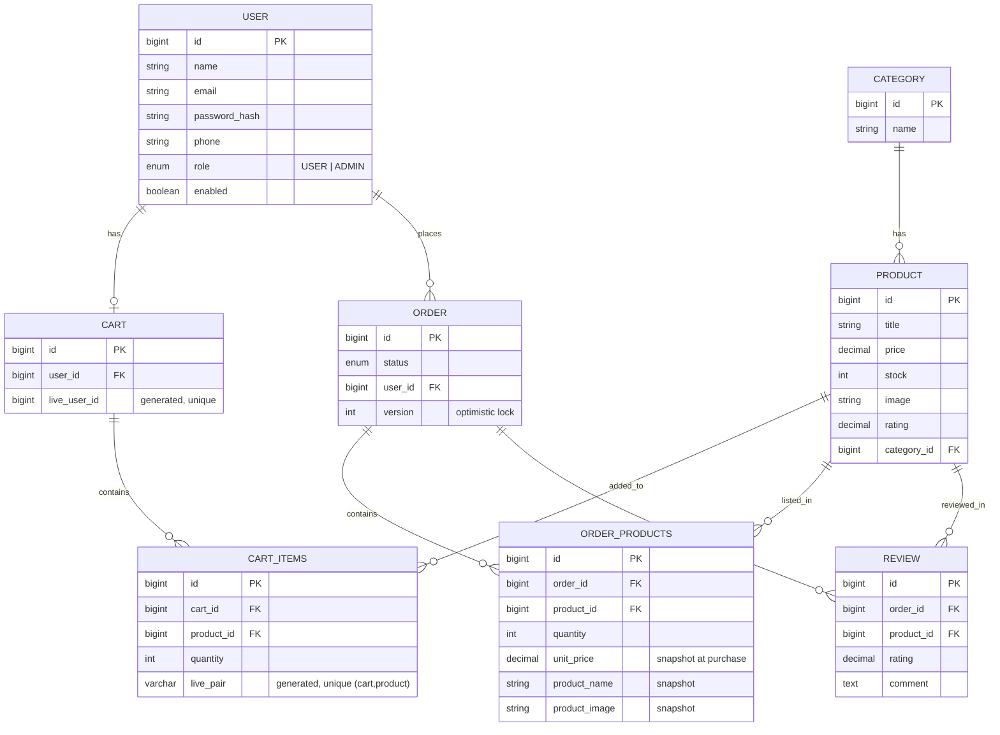

# NexusCommerce — Project Documentation

Complete reference for setup, technology stack, authentication, architecture, data-integrity guarantees, Redis caching (including refresh tokens, JWT blacklist, idempotency and rate-limit keys), observability, API flows, request payloads, deployment (Docker + CI), domain events, and real-world usage scenarios.

---

## Table of contents

1. [Overview](#1-overview)
2. [Technologies used](#2-technologies-used)
3. [Environment setup](#3-environment-setup)
4. [Application configuration](#4-application-configuration)
5. [Running the project](#5-running-the-project)
6. [Architecture and request flow](#6-architecture-and-request-flow)
7. [Authentication & authorization](#7-authentication--authorization)
8. [Domain model](#8-domain-model)
9. [Data integrity & migrations](#9-data-integrity--migrations)
10. [Redis state (cache, refresh tokens, blacklist, idempotency, rate limit)](#10-redis-state)
11. [Observability](#11-observability)
12. [API reference and payloads](#12-api-reference-and-payloads)
13. [Real-life scenarios](#13-real-life-scenarios)
14. [Error handling](#14-error-handling)
15. [Manual testing checklist](#15-manual-testing-checklist)
16. [CI, Docker & deployment](#16-ci-docker--deployment)
17. [Idempotency, rate limiting & domain events](#17-idempotency-rate-limiting--domain-events)
18. [Frontend workspace](#18-frontend-workspace)

---

## 1. Overview

**NexusCommerce** is a Spring Boot REST backend for a small e-commerce platform. It manages:

- **Users** — accounts with a BCrypt-hashed password and a role (`USER` / `ADMIN`); registration, JWT login, opaque rotating refresh tokens, and revocation on logout.
- **Categories** — product groupings (e.g. Electronics).
- **Products** — catalogue items linked to a category, each with a **stock** count and an image URL managed via an admin multipart upload endpoint.
- **Carts** — persistent, per-user shopping carts (`V13`) that survive browser sessions and close out into orders through the same code path as direct order creation.
- **Orders** — purchases with line items (product + quantity), placed by an authenticated user; stock is reserved atomically and line items are **snapshotted** with the price, product name and image at purchase time. Both order and cart-checkout writes accept an optional `Idempotency-Key` so a client retry never places a duplicate order.
- **Reviews** — post-purchase feedback tied to a specific order and product; at most one live review per `(order, product)` pair.

Every call beyond public browsing is secured with a **stateless JWT bearer token** and **role-based authorization**. Failed login attempts are rate-limited per IP with a Redis fixed-window counter.

All REST responses use a consistent **`ApiResponse<T>`** envelope. Read-heavy product, order, category, and review GET endpoints are cached in **Redis** through Spring's cache abstraction, and every write **evicts** the affected cache entries. **MySQL** is the system of record; **Flyway** owns the schema (`V1`–`V14`) and Hibernate runs in `validate` mode only.

Observability ships in two layers: **Spring Boot Actuator + Micrometer + Prometheus** for self-hosted metrics (admin-gated), and the **New Relic Java APM agent** attached on `bootRun` when its jar is present. The HTTP server shuts down gracefully on SIGTERM.

Deployment is a multi-stage **Dockerfile** (Temurin 21 build → non-root runtime, `/app/uploads/products` writable) plus a **GitHub Actions** workflow that builds, runs H2 unit tests, and then boots the real app against MySQL 8.4 + Redis 7 service containers and polls `/actuator/health` before declaring success.

**Base URL:** `http://localhost:<PORT>/api/v1` (default `PORT` from `.env`, commonly `3001`).

---

## 2. Technologies used

| Technology | Role in NexusCommerce | Version (project) |
|------------|----------------------|-------------------|
| **Java** | Runtime | 21 |
| **Spring Boot** | Web, DI, auto-configuration | 4.0.2 |
| **Spring WebMVC** | REST controllers | (via starter) |
| **Spring Security** | Stateless auth + method/path authorization | 7.x |
| **JWT (`jjwt`)** | Access-token issue & verification (HMAC) | 0.12.x |
| **Spring Data JPA** | Repositories, ORM | (via starter) |
| **Hibernate** | JPA provider, `ddl-auto: validate` | 7.x |
| **MySQL** | Primary database | 8.4 / 9.6 validated |
| **Flyway** | Versioned SQL migrations (`V1`–`V14`) | (via starter) |
| **Redis + Lettuce** | Spring Cache backend, refresh tokens, JWT blacklist, login rate limit, idempotency replay | Spring Data Redis |
| **Lombok** | Boilerplate reduction | compileOnly |
| **springdoc-openapi** | Swagger UI / OpenAPI 3 (+ bearer scheme) | 2.8.5 |
| **Bean Validation** | Declarative `@Valid` on DTOs | (via starter) |
| **Gradle** | Build and `bootRun` | 9.x wrapper |
| **Actuator + Micrometer** | `/health`, `/info`, `/metrics`, `/prometheus` | `micrometer-registry-prometheus` runtimeOnly |
| **New Relic Java agent** | Optional APM (attached only if the jar exists) | `newrelic/` directory |
| **Logback + logstash encoder** | Structured JSON logs to ELK | runtime |
| **Docker** | Multi-stage image | Temurin 21 |
| **GitHub Actions** | CI pipeline | `.github/workflows/ci.yml` |
| **Jackson** | JSON (API + Redis value serialization) | (Spring Boot managed) |

---

## 3. Environment setup

### 3.1 Prerequisites

Install on your machine:

| Tool | Purpose |
|------|---------|
| **JDK 21** | Compile and run |
| **MySQL** 8.x+ | Database server |
| **Redis** 7.x+ | Cache, token store, rate limiter |
| **Docker** *(optional)* | Container image + local ELK/compose stack |
| **Git** | Clone repo |

Verify:

```bash
java -version    # should show 21
mysql --version
redis-cli --version
docker --version # optional
```

### 3.2 MySQL setup

1. Start MySQL service.
2. Create database:

```sql
CREATE DATABASE nexuscommerce CHARACTER SET utf8mb4 COLLATE utf8mb4_unicode_ci;
```

3. Ensure a user can connect to `localhost:3306` with rights on `nexuscommerce`.

**Tables** are created and versioned by **Flyway** on first app start (migrations `V1`–`V14` under `src/main/resources/db/migration/`). Hibernate only validates the schema; it never alters it.

### 3.3 Redis setup

1. Start Redis (default port **6379**):

```bash
# macOS (Homebrew example)
brew services start redis

# or foreground
redis-server
```

2. Verify:

```bash
redis-cli ping
# PONG
```

Redis is used for five distinct things (see §10): GET cache, refresh-token store, JWT blacklist, login rate-limit counter, and idempotency replay. The GET cache degrades gracefully on Redis failures (a `CacheErrorHandler` falls through to MySQL, and the 500 ms Lettuce connect/read timeouts bound any hang), **but** refresh tokens, blacklist, and idempotency are correctness-critical — a Redis outage effectively disables logout, refresh, idempotent retries, and login rate limiting until it returns.

### 3.4 Project configuration file (`.env`)

Create `.env` in the project root (git-ignored — never commit it):

```properties
PORT=3001
username=your_mysql_user
password=your_mysql_password
redis_port=6379

JWT_SECRET=change-me-to-a-long-random-secret-at-least-32-bytes
JWT_EXPIRATION_MINUTES=120
JWT_REFRESH_EXPIRATION_DAYS=7

LOGIN_RATE_MAX=10
LOGIN_RATE_WINDOW_SECONDS=60

UPLOAD_DIR=uploads/products
```

Spring loads it via `spring.config.import: optional:file:.env[.properties]` in `application.yml`. `JWT_SECRET` has a dev-only default baked into `application.yml` so the app boots without a secret file, but **always override it outside local dev**.

### 3.5 New Relic (optional)

- Agent JAR lives at `newrelic/newrelic.jar` — **gitignored**; attach only if you place the file there yourself.
- `newrelic/newrelic.yml` sets `app_name: NexusCommerce` and **does not contain a license key** — the `license_key:` line is commented out.
- Supply the license key via the **`NEW_RELIC_LICENSE_KEY` environment variable**. Never paste it into `newrelic.yml`.
- `./gradlew bootRun` attaches `-javaagent:newrelic/newrelic.jar` **conditionally** — the flag is added only when the JAR exists (see `build.gradle`). CI and Docker builds therefore boot cleanly without the agent.

> **Leaked key caveat.** Before commit `dcaaaf8`, a real New Relic license key was committed at `newrelic/newrelic.yml`. It has been removed from every current branch but **is still reachable in git history**. Treat it as compromised: revoke it at the New Relic admin console, and if you want to purge the blob, use `git filter-repo --invert-paths --path newrelic/newrelic.yml` followed by a coordinated `git push --force` with every collaborator.

---

## 4. Application configuration

| Property | Source | Description |
|----------|--------|-------------|
| `server.port` | `${PORT}` | HTTP port (commonly `3001`) |
| `server.shutdown` | `graceful` | In-flight requests finish before JVM exit |
| `spring.lifecycle.timeout-per-shutdown-phase` | `30s` | Upper bound for the graceful drain |
| `server.compression` | `application.yml` | gzip on JSON responses ≥ 2 KB |
| `spring.datasource.url` | `application.yml` | `jdbc:mysql://localhost:3306/nexuscommerce` (+ prepared-statement cache, batch rewrite) |
| `spring.datasource.username` | `${username}` | MySQL user |
| `spring.datasource.password` | `${password}` | MySQL password |
| `spring.datasource.hikari` | `application.yml` | pool max 20, min idle 5, 3 s checkout timeout, `nexus-pool` JMX name |
| `spring.data.redis.host` | `application.yml` | `localhost` |
| `spring.data.redis.port` | `${redis_port}` | Redis port |
| `spring.data.redis.timeout` / `connect-timeout` | `application.yml` | 500 ms each — turns a hung Redis into a fast fallback, not a stall |
| `spring.jpa.hibernate.ddl-auto` | `validate` | Schema managed by Flyway only |
| `spring.jpa.show-sql` | `false` | SQL off; use the `org.hibernate.SQL` logger when needed |
| `spring.jpa.open-in-view` | `false` | Requests never hold a DB connection through serialization; fetch associations explicitly |
| `spring.jpa.properties.hibernate.jdbc.batch_size` | `50` | Write batching |
| `spring.jpa.properties.hibernate.jdbc.fetch_size` | `2000` | Large joins in one round trip |
| `spring.servlet.multipart.max-file-size` | `5MB` | Product image upload cap (enforced again by `ProductImageUploadService`) |
| `spring.servlet.multipart.max-request-size` | `6MB` | Multipart form total |
| `spring.flyway.enabled` | `true` | Runs migrations on startup |
| `app.jwt.secret` | `${JWT_SECRET}` | HMAC signing key (≥ 32 bytes) |
| `app.jwt.expiration-minutes` | `${JWT_EXPIRATION_MINUTES}` | Access-token lifetime (default 120) |
| `app.jwt.refresh-expiration-days` | `${JWT_REFRESH_EXPIRATION_DAYS}` | Opaque refresh-token TTL in Redis (default 7) |
| `app.upload.dir` | `${UPLOAD_DIR}` | Local directory for product image uploads (default `uploads/products`) |
| `app.rate-limit.login.max` | `${LOGIN_RATE_MAX}` | Login attempts per window per IP (default 10) |
| `app.rate-limit.login.window-seconds` | `${LOGIN_RATE_WINDOW_SECONDS}` | Fixed window length (default 60 s) |
| `management.endpoints.web.exposure.include` | `health,info,metrics,prometheus` | Only these are HTTP-reachable |
| `management.endpoint.health.show-details` | `when-authorized` | Anon sees only `status`; `ROLE_ADMIN` sees component states |
| `management.endpoint.health.probes.enabled` | `true` | Enables `/liveness` and `/readiness` |
| `management.metrics.tags.application` | `${spring.application.name}` | Adds `application=NexusCommerce` to every Micrometer metric |
| `springdoc.swagger-ui.*` | `alpha` sorters, `doc-expansion: none` | Deterministic, tidy Swagger layout |

---

## 5. Running the project

```bash
cd NexusCommerce
./gradlew bootRun
```

**Swagger UI:** `http://localhost:<PORT>/swagger-ui/index.html`
**OpenAPI JSON:** `http://localhost:<PORT>/v3/api-docs`
**Health probe:** `http://localhost:<PORT>/actuator/health`

Swagger exposes an **Authorize** button (bearer scheme): log in, copy `data.token`, paste it there, and protected endpoints become callable.

**Tests:**

```bash
./gradlew test
```

Tests use H2 in-memory; no MySQL or Redis required.

**Docker image:**

```bash
docker build -t nexuscommerce:local .
docker run --rm -p 3001:3001 \
  -e username=root -e password=secret \
  -e JWT_SECRET=replace-me-with-a-32+-byte-secret \
  -v "$(pwd)/uploads:/app/uploads" \
  nexuscommerce:local
```

---

## 6. Architecture and request flow

### 6.1 High-level architecture

```mermaid
flowchart TB
    Client[Client / Swagger / Frontend]
    Tomcat[Spring Boot Tomcat]
    Sec[Spring Security filter chain + JwtAuthFilter + LoginRateLimiterInterceptor]
    Controller[Controllers]
    Service[Services]
    Cache[Spring Cache]
    Events[OrderEventListener (@Async AFTER_COMMIT)]
    Repo[JPA Repositories]
    MySQL[(MySQL)]
    Redis[(Redis)]
    NR[New Relic Agent - optional]

    Client --> Tomcat --> Sec --> Controller --> Service
    Service --> Cache --> Redis
    Service --> Repo --> MySQL
    Service -. publishes .-> Events
    Sec -. refresh/blacklist/rate-limit lookups .-> Redis
    Sec -. authn/authz .-> Controller
    Tomcat -.-> NR
```

### 6.2 Layered flow (single authenticated GET request)

```mermaid
sequenceDiagram
    participant C as Client (Bearer token)
    participant F as JwtAuthFilter
    participant CT as Controller
    participant S as Service
    participant R as Redis Cache
    participant DB as MySQL

    C->>F: GET /api/v1/orders/3 (Authorization: Bearer …)
    F->>F: verify JWT signature + expiry
    F->>R: EXISTS jwt:blacklist::&lt;jti&gt;?
    alt revoked
        F-->>C: 401 Unauthorized!
    else ok
        F->>F: set SecurityContext(AuthenticatedUser)
        F->>CT: allow (authenticated / admin / owner)
        CT->>S: getOrderById(3)
        S->>R: order:by-id::3
        alt Cache hit
            R-->>S: GetOrderResponseDto
        else Cache miss
            S->>DB: findById + line items
            DB-->>S: entities
            S->>R: put(order:by-id::3) on commit
        end
        S-->>CT: DTO
        CT-->>C: ApiResponse JSON
    end
```

### 6.3 Typical write flow (evicts cache on commit, publishes event)

```mermaid
sequenceDiagram
    participant C as Client (Bearer token)
    participant CT as OrderController
    participant I as IdempotencyService
    participant S as OrderService
    participant DB as MySQL
    participant R as Redis
    participant EV as OrderEventListener

    C->>CT: POST /api/v1/orders (Idempotency-Key: uuid)
    CT->>I: tryStart(userId, "orders", key)
    I->>R: SET idem::u::orders::key = __IN_FLIGHT__ NX EX 600
    alt cached result
        R-->>CT: previous ApiResponse
        CT-->>C: 201 replay
    else new
        CT->>S: createOrder(dto, caller.id)
        S->>DB: atomic stock decrement + save Order + line items (snapshots)
        S->>DB: COMMIT
        S->>R: @CacheEvict order/product caches (post-commit)
        S-->>CT: GetOrderResponseDto
        CT->>I: complete(userId, "orders", key, ApiResponse)
        I->>R: SET idem::u::orders::key = &lt;json&gt; EX 86400
        CT-->>C: 201 Created + ApiResponse
        DB-->>EV: OrderPlacedEvent (AFTER_COMMIT, @Async)
        EV->>EV: notificationService.sendOrderConfirmation(...)
    end
```

> **Notes.**
> - Writes **do** invalidate the relevant cache entries. Eviction is scheduled to run only after the surrounding transaction commits, so a rolled-back write never leaves a stale-but-cached result, and a concurrent read never populates the cache from pre-commit data.
> - Domain events fire strictly `AFTER_COMMIT` and are handled on the async executor — a listener failure can never roll back the write.

### 6.4 Project package layout

```
com.example.nexusCommerce/
├── controllers/     REST API (Auth, Cart, Users, Categories, Products, Orders, Reviews, Admin)
├── services/        Business logic (interface + *ServiceImpl) incl. CartService, ProductImageUploadService, NotificationService
├── repositories/    Spring Data JPA (CartRepository, UserRepository, ProductRepository, …)
├── schema/          Entities (User, Category, Product, Order, OrderProducts, Review, Cart, CartItem) + Role/OrderStatus enums
├── dtos/            Request/response objects (incl. AddToCartRequestDto, CartResponseDto, RefreshRequestDto)
├── adapters/        Entity ↔ DTO mapping (OrderAdapter, ReviewAdapter, …)
├── security/        JwtService, JwtAuthFilter, AuthenticatedUser, RefreshTokenService, TokenBlacklistService, IdempotencyService, LoginRateLimiterInterceptor
├── events/          OrderPlacedEvent, OrderStatusChangedEvent, OrderEventListener (@Async @TransactionalEventListener)
├── exceptions/      Custom exceptions + GlobalExceptionHandler
├── configs/         SecurityConfig, WebMvcConfig (rate-limiter interceptor + /uploads resource handler), AsyncConfig (@EnableAsync), CacheConfig, JpaAuditingConfig, PasswordEncoderConfig, SwaggerConfig
└── utils/           ApiResponse, PageResponse, Pagination
```

Caching is declarative (`@Cacheable` / `@CacheEvict`) on the service methods — there is **no** hand-written cache class per domain.

---

## 7. Authentication & authorization

### 7.1 Token lifecycle

NexusCommerce uses a **two-token model**:

- **Access token** — short-lived (default 120 min) HMAC-signed JWT carrying `{sub, uid, role, jti}`. Sent on every protected request as `Authorization: Bearer <jwt>`. Stateless to verify, but revocable via a Redis `jti` blacklist until expiry.
- **Refresh token** — opaque 32-byte `SecureRandom` Base64url string, **not a JWT**. Stored in Redis under `refresh::<token> → userId` with a TTL (`JWT_REFRESH_EXPIRATION_DAYS`, default 7 days). Single-use: `/refresh` consumes it, issues a new pair, and the previous token is deleted.

**Flows:**

1. **Register** — `POST /api/v1/users` (public). New accounts get role `USER`. Password is **BCrypt-hashed** before storage.
2. **Log in** — `POST /api/v1/auth/login` (public, rate-limited) → returns `{ token, tokenType: "Bearer", expiresAt, refreshToken, user }`.
3. **Call** — send `Authorization: Bearer <access>`. `JwtAuthFilter` verifies signature + expiry, checks `jwt:blacklist::<jti>`, and populates an `AuthenticatedUser(id, email, role)` principal available to controllers via `@AuthenticationPrincipal`.
4. **Refresh** — `POST /api/v1/auth/refresh` with `{ "refreshToken": "…" }`. `RefreshTokenService.consume()` GET-then-DELETES the key atomically (single-use), re-issues a full pair, and rejects if the user was disabled. Attempting to reuse a consumed refresh token → 401.
5. **Log out** — `POST /api/v1/auth/logout` with the current `Authorization` header **and** `{ "refreshToken": "…" }`. The service parses the access token's `jti`, writes `jwt:blacklist::<jti>` with TTL = remaining token lifetime, and deletes `refresh::<token>`. After this, the same access token is treated as unauthenticated until natural expiry.

**Claims:** `sub` = email, `uid` = user id, `role`, `jti` = random UUID (used for revocation). Signed with the HMAC `JWT_SECRET` (algorithm derived from key length; the bundled dev secret yields HS512). Invalid, expired, or unsigned tokens are treated as unauthenticated.

**Bootstrapping the first admin:** two mechanisms exist.

1. **V14 seed** — the `V14__seed_admin_role.sql` migration promotes `root-admin@nexuscommerce.test` to `ROLE_ADMIN` if that account already exists (or on a subsequent re-run after you register it). **Rotate or delete this seed before deploying anywhere real.**
2. **Manual promote** — set a row's `role` to `ADMIN` in MySQL directly, or use an existing admin via `PATCH /api/v1/admin/users/{id}`, then log in again — the role travels in the token.

**Login rate limit** — `LoginRateLimiterInterceptor` is registered for `POST /api/v1/auth/login` only. It uses a fixed-window Redis counter keyed on the client IP (first `X-Forwarded-For` entry, else `getRemoteAddr`), with `INCR` + `EXPIRE` on first hit. Over the threshold → **429 Too Many Requests** with the standard `ApiResponse` envelope. Redis resolved lazily via `ObjectProvider`; the interceptor is a no-op when Redis isn't available (e.g. H2 test slices).

### 7.2 Authorization matrix (from `SecurityConfig`)

| Access level | Routes |
|--------------|--------|
| **Public (no token)** | `/api/v1/auth/**` (login, refresh, logout), `POST /api/v1/users`, Swagger/OpenAPI paths, `GET /uploads/**`, `GET /actuator/health`, `GET /actuator/health/liveness`, `GET /actuator/health/readiness`, and **GET** on `/api/v1/products/**`, `/api/v1/categories/**`, `/api/v1/reviews/**`. |
| **Any authenticated user** | All `/api/v1/cart/**` endpoints (get, add, update, remove, clear, checkout), `POST /api/v1/reviews`, `POST /api/v1/orders`, `GET /api/v1/orders/me`, `GET /api/v1/orders/{id}`, `GET /api/v1/orders/{id}/summary`, `PUT /api/v1/orders/{id}` — order read/update are additionally scoped so a non-admin can only touch their **own** orders. |
| **`ROLE_ADMIN` only** | All **writes** on products and categories (POST/PUT/DELETE), `POST /api/v1/admin/products/{id}/image`, **DELETE** on reviews, the order **list** (`GET /api/v1/orders`), **DELETE** on orders, the entire `/api/v1/admin/**`, viewing any user's orders via `GET /api/v1/orders/user/{userId}`, and everything under `/actuator/**` except the health probes. |

Anything not matched above requires authentication. `401 Unauthorized!` is returned when a token is missing, invalid, or blacklisted; `403 Forbidden!` when the caller is authenticated but lacks the role or ownership.

### 7.3 Password & secret handling

- `PasswordEncoderConfig` exposes a BCrypt encoder; plaintext passwords are never stored or returned.
- The JWT secret comes from `JWT_SECRET`; the fallback in `application.yml` is a fixed dev-only value. Rotate it for any real deployment.
- Refresh tokens are generated by `SecureRandom` (32 bytes) and Base64url-encoded — they are opaque random strings, not derived from any secret, so a Redis dump is required to abuse them.
- New Relic license key **must** come from `NEW_RELIC_LICENSE_KEY` env; never commit it.

---

## 8. Domain model



Every table also carries `created_datetime`, `updated_datetime`, and (via soft-delete) `deleted_datetime`.

**Cart rules:**

- Exactly **one live cart per user** — enforced by `uk_carts_live_user` on the generated `live_user_id` column, so soft-deleted carts free the slot.
- **One live line per (cart, product)** — enforced by `uk_cart_items_live_pair`; adding a product already on the cart **sums the quantity** instead of creating a second line.
- `getMyCart` returns a synthetic empty cart (`items: []`, `grandTotal: 0`) on first access without persisting it, so browsing a cart doesn't create rows.
- `checkout(userId, override)` refuses empty carts, optionally swaps in the caller's `orderItems` list, delegates to `OrderService.createOrder` (same stock reservation + snapshot pipeline), and clears the cart on success.

**Review rules:**

- Product must exist on the order (as a line item).
- At most **one review per (orderId, productId)** — enforced at the DB level on live rows.
- Rating: **> 0** and **≤ 10**.

---

## 9. Data integrity & migrations

Design guarantees that are worth knowing before modifying the domain:

- **Soft delete everywhere** — Every entity uses `@SQLDelete` (UPDATE … SET `deleted_datetime`) + `@SQLRestriction(deleted_datetime IS NULL)`. Deletes hide rows from reads without destroying history.
- **Optimistic locking** — `Order` has a `@Version` column (added in `V8`); its soft-delete SQL is version-guarded so concurrent writers collide instead of silently overwriting.
- **Oversell-safe stock** — Reserving/adjusting stock uses an atomic conditional bulk UPDATE (`WHERE stock >= :qty`). Zero affected rows means insufficient stock and the whole transaction rolls back, so partial oversells cannot commit. Returning stock on delete/remove is an atomic `increaseStock`.
- **Line-item snapshots** — `order_products` stores `unit_price` (`V11`) plus `product_name` / `product_image` (`V12`), all backfilled. Editing a price, renaming, or soft-deleting a product therefore cannot rewrite historical orders or revenue, and a deleted product's line item still renders (the read path no longer inner-joins products).
- **Uniqueness that survives soft-delete** — Flyway generated columns mirror each unique key only for live rows (`V8` unique names, `V10` one live review per `(order, product)`, `V13` one live cart per user and one live `(cart, product)` line). Deleting a row frees the slot without a partial index.
- **Idempotency on writes** — Order and cart-checkout accept `Idempotency-Key`. First call writes `__IN_FLIGHT__` (TTL 10 min), on success overwrites with the JSON response (TTL 24 h), on failure deletes the key. Concurrent same-key → `400 InvalidRequestException`. Re-acquisition of an expired in-flight marker uses a **second `SETNX`** rather than a plain `SET`, so two racing clients cannot both take over.
- **Revocation is Redis-backed** — Logout writes `jwt:blacklist::<jti>` with TTL = remaining token life. Refresh tokens live only as opaque random 32-byte values keyed by `refresh::<token>` with rotation on every refresh — a stolen refresh token can only be used once.
- **Schema is code** — `ddl-auto: validate`; **Flyway** owns DDL. Add a new `V__` migration for any change — never edit an applied one.

### Migration history

| Migration | Purpose |
|-----------|---------|
| `V1__init_schema` | Initial categories / products / orders / order_products tables |
| `V2__update_rating_to_decimal` | rating → decimal |
| `V3__add_reviews_table` | reviews table |
| `V4__add_product_price_index` | index on product price (later dropped by V7) |
| `V5__add_users_and_order_user` | users table + order→user link |
| `V6__add_password_hash_to_users` | `password_hash` for auth |
| `V7__lookup_indexes` | Functional lower-case indexes for `*IgnoreCase` derived queries + composite `idx_reviews_order_product`; **conditional** drops of `fk_review_order` and `idx_product_price` guarded by `information_schema.STATISTICS` (see note below) |
| `V8__order_version_and_unique_names` | order `version` + soft-delete-safe unique names |
| `V9__add_role_and_stock` | `users.role`, `users.enabled`, `products.stock` |
| `V10__unique_active_review` | DB unique on live `(order_id, product_id)` reviews |
| `V11__snapshot_order_unit_price` | `order_products.unit_price` snapshot (backfilled) |
| `V12__snapshot_order_product_identity` | `order_products.product_name` / `product_image` snapshot (backfilled) |
| `V13__shopping_carts` | `carts` + `cart_items` tables with generated live-scope uniqueness columns |
| `V14__seed_admin_role` | Dev-only seed: promote `root-admin@nexuscommerce.test` to `ADMIN` (delete before real deployment) |

> **Why V7 uses a stored procedure.** On a fresh MySQL 8.4 database, `CREATE INDEX idx_reviews_order_product ON reviews (order_id, product_id)` makes the server **automatically drop** the FK-supporting index `fk_review_order`, because the composite already covers it. An unconditional `DROP INDEX fk_review_order` therefore fails with `1091 Can't DROP` — exactly what broke CI before commit `2afc8e8`. V7 now wraps both drops in `drop_index_if_present`, which reads `information_schema.STATISTICS` first and no-ops when the index isn't there. This lets one migration apply cleanly to both fresh CI databases and older dev databases that pre-date the composite.

---

## 10. Redis state

Redis stores five logically distinct kinds of state. Every key carries a namespace prefix so the different purposes are easy to inspect, expire selectively, or flush.

### 10.1 Cache (`@Cacheable` / `@CacheEvict`)

Spring's **cache abstraction** (`@EnableCaching`) backed by **`RedisCacheManager`** over **Lettuce**. Service methods are annotated declaratively — there is no manual cache-aside code.

- **Values:** JSON via a Jackson serializer; keys are strings. At runtime Spring prefixes the key with the cache name, e.g. `product:by-id::1`, `order:all::0:20`.
- **TTLs (per cache):** list caches **5 min**, single-item caches **10 min**, aggregate `product:unique-categories` **15 min**.
- **Null caching:** on — a lookup of a non-existent id is memoized so it cannot hammer the DB.
- **Transaction-aware:** puts/evictions are deferred until the surrounding transaction commits.
- **Resilience:** a `CacheErrorHandler` degrades to the database on Redis failures, and 500 ms timeouts bound any hang. A local fallback (`spring.cache.type` != `redis`) uses an in-memory cache manager.

### 10.2 Cache names & key expressions

| Cache name | Key | Populated by | Evicted on |
|------------|-----|--------------|------------|
| `product:all` | `page:size` | list | product/category writes (all entries) |
| `product:by-id` | `id` | get by id | product updates (all entries) |
| `product:details` | `id` | get with details | product updates (all entries) |
| `product:by-category` | `name:page:size` | search by category | product/category writes |
| `product:unique-categories` | — | distinct category names | product writes |
| `category:all` | `page:size` | list | category writes |
| `category:by-id` | `id` | get by id | category writes |
| `order:all` | `page:size` | admin list | order writes (all entries) |
| `order:by-id` | `id` | get order | order writes on that id |
| `order:summary` | `id` | get summary | order writes on that id |
| `review:all` | `page:size` | list | review writes |
| `review:by-id` | `id` | get by id | review writes |
| `review:by-product` | `productId:page:size` | by product | review writes |
| `review:by-order` | `orderId:page:size` | by order | review writes |

Because list keys include `page`/`size`, list evictions use `allEntries = true`.

### 10.3 Refresh tokens (`RefreshTokenService`)

| Prefix | Value | TTL | Notes |
|--------|-------|-----|-------|
| `refresh::<opaque-32-byte-token>` | `userId` (Long) | `JWT_REFRESH_EXPIRATION_DAYS` (default 7 d) | Opaque `SecureRandom` + Base64url. Single-use: `consume()` does `GET` then `DEL`. Logout deletes directly. |

### 10.4 JWT blacklist (`TokenBlacklistService`)

| Prefix | Value | TTL | Notes |
|--------|-------|-----|-------|
| `jwt:blacklist::<jti>` | empty marker | remaining life of the access token | Written on logout. `JwtAuthFilter` consults it before authenticating so a stolen access token can be killed before it expires. |

### 10.5 Idempotency replay (`IdempotencyService`)

| Prefix | Value | TTL | Notes |
|--------|-------|-----|-------|
| `idem::<userId>::<scope>::<key>` | `__IN_FLIGHT__` sentinel during the write, then the JSON `ApiResponse` on success | In-flight: 10 min; result: 24 h | Scopes in use: `orders` (POST /orders) and `cart-checkout` (POST /cart/checkout). Key is **user-scoped** so the same UUID from two different users is not replayed. Concurrent in-flight on the same key → `400`. Failed writes call `release()` and delete the key so the next attempt is fresh. |

### 10.6 Login rate limit (`LoginRateLimiterInterceptor`)

| Prefix | Value | TTL | Notes |
|--------|-------|-----|-------|
| `rate::login::<client-ip>` | integer counter | `LOGIN_RATE_WINDOW_SECONDS` (default 60 s) | Fixed-window `INCR` with `EXPIRE` on first hit. Client IP = first `X-Forwarded-For` entry, else `getRemoteAddr`. Only applied to `POST /api/v1/auth/login`. |

### 10.7 Inspecting keys

```bash
redis-cli -p 6379 KEYS "product:*"
redis-cli -p 6379 KEYS "order:*"
redis-cli -p 6379 --scan --pattern "review:*" | head
redis-cli -p 6379 KEYS "refresh::*"
redis-cli -p 6379 KEYS "jwt:blacklist::*"
redis-cli -p 6379 KEYS "idem::*"
redis-cli -p 6379 KEYS "rate::login::*"
redis-cli -p 6379 GET "idem::4::orders::$(uuidgen)"
```

---

## 11. Observability

### 11.1 Actuator + Micrometer + Prometheus (built in)

| Path | Access | Purpose |
|------|--------|---------|
| `GET /actuator/health` | Public (details admin-only) | Aggregate health. Anon callers see only `{"status":"UP"}`. |
| `GET /actuator/health/liveness` | Public | Kubernetes liveness probe. |
| `GET /actuator/health/readiness` | Public | Kubernetes readiness — pair with graceful shutdown. |
| `GET /actuator/info` | `ROLE_ADMIN` | Application info. |
| `GET /actuator/metrics` | `ROLE_ADMIN` | List Micrometer metric names. |
| `GET /actuator/metrics/{name}` | `ROLE_ADMIN` | Metric detail / per-tag buckets. |
| `GET /actuator/prometheus` | `ROLE_ADMIN` | Prometheus text exposition, tagged `application=NexusCommerce`. |

Anything not listed is **not** exposed on the wire — `/actuator/shutdown`, `/actuator/env`, `/actuator/configprops` etc. are intentionally left off `management.endpoints.web.exposure.include`.

### 11.2 Graceful shutdown

`server.shutdown: graceful` + `spring.lifecycle.timeout-per-shutdown-phase: 30s`. On SIGTERM, Tomcat stops accepting new connections and lets in-flight requests finish (bounded by 30 s) before the JVM exits. Combined with the readiness probe, that makes rolling restarts safe behind a load balancer.

### 11.3 New Relic APM (optional)

- Attach is **conditional** on `newrelic/newrelic.jar` existing — CI and Docker builds therefore boot cleanly without it.
- App name **`NexusCommerce`** (set in `newrelic/newrelic.yml`).
- License key **only** via `NEW_RELIC_LICENSE_KEY` env. Never in the file.
- Agent logs go to `newrelic/logs/newrelic_agent.log` (gitignored).

### 11.4 Structured logs

Logback + `logstash-logback-encoder` ship to Logstash on `localhost:5044` when the ELK stack from `docker-compose.yml` is running. Without Logstash, the appender logs a WARN and drops — startup is unaffected.

### 11.5 App / SQL logs

- `spring.jpa.show-sql: false`. Turn on `logging.level.org.hibernate.SQL=DEBUG` locally when needed; production stays at WARN.
- Default Logback pattern in `application.yml` writes `date thread level logger - message` on stdout.

---

## 12. API reference and payloads

### 12.1 Response envelope

**Success:**

```json
{ "success": true, "message": "Human-readable message", "error": null, "data": { } }
```

**Error:**

```json
{ "success": false, "message": "Resource Not Found!", "error": "Detailed error text", "data": null }
```

Paged `data` is a **`PageResponse`**:

```json
{ "content": [ ], "page": 0, "size": 20, "totalElements": 137, "totalPages": 7, "last": false }
```

List endpoints accept `?page=0&size=20` (defaults shown; `size` is clamped server-side). Add `-H "Authorization: Bearer <token>"` for any non-public route.

### 12.2 Auth & users

| Method | Path | Access | Body |
|--------|------|--------|------|
| POST | `/api/v1/users` | Public | `CreateUserRequestDto` |
| POST | `/api/v1/auth/login` | Public (rate-limited) | `LoginRequestDto` |
| POST | `/api/v1/auth/refresh` | Public | `RefreshRequestDto` |
| POST | `/api/v1/auth/logout` | Public (needs Bearer) | `RefreshRequestDto` |

**Register (`CreateUserRequestDto`):** `name` (required), `email` (valid, unique), `password` (≥ 8 chars), `phone` (optional). Returns 201 with the created user (`role: "USER"`).

```json
{ "name": "Rahul", "email": "rahul@example.com", "password": "secret123", "phone": "9999999999" }
```

**Login body (`LoginRequestDto`):**

```json
{ "email": "rahul@example.com", "password": "secret123" }
```

Login response `data`:

```json
{
  "token": "<jwt>",
  "tokenType": "Bearer",
  "expiresAt": "2026-10-22T12:00:00Z",
  "refreshToken": "<opaque single-use>",
  "user": { "id": 4, "name": "Rahul", "email": "rahul@example.com", "role": "USER", "enabled": true }
}
```

**Refresh body (`RefreshRequestDto`):**

```json
{ "refreshToken": "8Yw2…opaque…" }
```

Refresh response is identical in shape to the login response — new access token **and** new refresh token. The submitted refresh token is deleted from Redis; using it a second time returns 401.

**Logout body (`RefreshRequestDto`):**

```json
{ "refreshToken": "8Yw2…opaque…" }
```

Send the request with `Authorization: Bearer <current-access-token>`. Response has `data: null` and `message: "Signed out"`. Side effects: Redis key `jwt:blacklist::<current jti>` written with TTL = remaining access-token life; `refresh::<submitted token>` deleted.

**Rate-limit behaviour** — hitting login over `LOGIN_RATE_MAX` within the window returns **429**:

```json
{ "success": false, "message": "Too many login attempts", "error": "Rate limit exceeded", "data": null }
```

### 12.3 Categories — `/api/v1/categories`

| Method | Path | Access | Body | Cache |
|--------|------|--------|------|-------|
| GET | `/` | Public | page/size | `category:all` |
| GET | `/{id}` | Public | — | `category:by-id` |
| POST | `/` | ADMIN | below | evict |
| PUT | `/{id}` | ADMIN | below | evict |
| DELETE | `/{id}` | ADMIN | — | evict (rejected if it has live products) |

**Body (`CreateCategoryRequestDto`):**

```json
{ "name": "Electronics" }
```

### 12.4 Products — `/api/v1/products`

| Method | Path | Access | Body / params | Cache |
|--------|------|--------|---------------|-------|
| GET | `/` | Public | page/size | `product:all` |
| GET | `/{id}` | Public | — | `product:by-id` |
| GET | `/{id}/details` | Public | — | `product:details` |
| GET | `/search?categoryName=` | Public | + page/size | `product:by-category` |
| GET | `/uniqueCategories` | Public | — | `product:unique-categories` |
| POST | `/` | ADMIN | below | evict |
| PUT | `/{id}` | ADMIN | below (partial) | evict |
| DELETE | `/{id}` | ADMIN | — | evict (soft delete) |

**POST body (`CreateProductRequestDto`):**

```json
{
  "title": "Wireless Headphones",
  "description": "Noise-cancelling over-ear headphones",
  "price": 4999.00,
  "image": "https://example.com/headphones.png",
  "categoryId": 1,
  "rating": 4.5,
  "stock": 25
}
```

**PUT body (`UpdateProductRequestDto`)** is a **partial merge** — only non-null fields change (any of `title`, `description`, `price`, `image`, `rating`, `stock`, `categoryId`):

```json
{ "price": 4599.00, "stock": 40 }
```

### 12.5 Cart — `/api/v1/cart` (any authenticated user)

| Method | Path | Body | Notes |
|--------|------|------|-------|
| GET | `/` | — | Lazily creates on first call. |
| POST | `/items` | `AddToCartRequestDto` | 201 with fresh cart |
| PATCH | `/items/{id}` | `UpdateCartItemRequestDto` | Owner-scoped |
| DELETE | `/items/{id}` | — | Owner-scoped |
| DELETE | `/` | — | Empties the cart |
| POST | `/checkout` | optional `CreateOrderRequestDto`; optional `Idempotency-Key` header | 201 with the created order |

**Add-to-cart body (`AddToCartRequestDto`):**

```json
{ "productId": 1, "quantity": 2 }
```

If the same `productId` is already on a line, the quantity is **added** to the existing line rather than creating a second one.

**Update cart item body (`UpdateCartItemRequestDto`):**

```json
{ "quantity": 5 }
```

**Cart response (`CartResponseDto`):**

```json
{
  "id": 12,
  "userId": 4,
  "items": [
    {
      "id": 41,
      "productId": 1,
      "productName": "Wireless Headphones",
      "productImage": "/uploads/products/2f6a9b0d-…png",
      "unitPrice": 4599.00,
      "quantity": 5,
      "lineTotal": 22995.00
    }
  ],
  "grandTotal": 22995.00,
  "itemCount": 1
}
```

Line totals / grand total are **computed at read time** from the current catalogue — they are not persisted snapshots (that's the order line items' job).

**Checkout body** — optional override of the cart lines (`CreateOrderRequestDto` shape):

```json
{
  "orderItems": [
    { "productId": 1, "quantity": 2 },
    { "productId": 7, "quantity": 1 }
  ]
}
```

Omit the body entirely to check out the cart **as-is**. Add `Idempotency-Key: <uuid>` (header) to make the submission retry-safe; scope is `"cart-checkout"` in the Redis key.

Empty cart → `400 InvalidRequestException`. Insufficient stock → `400`, cart is untouched. On success, the cart is cleared and the created order is returned in `data` with all snapshots.

### 12.6 Orders — `/api/v1/orders`

| Method | Path | Access | Body | Cache |
|--------|------|--------|------|-------|
| POST | `/` | User (optional `Idempotency-Key`) | below | evict |
| GET | `/me` | User | page/size | — |
| GET | `/{id}` | Owner/ADMIN | — | `order:by-id` |
| GET | `/{id}/summary` | Owner/ADMIN | — | `order:summary` |
| PUT | `/{id}` | Owner/ADMIN | below | evict |
| GET | `/` | ADMIN | page/size | `order:all` |
| GET | `/user/{userId}` | Owner/ADMIN | page/size | — |
| DELETE | `/{id}` | ADMIN | — | evict |

**POST body (`CreateOrderRequestDto`):** placed on the authenticated caller; reserves stock atomically. Add an `Idempotency-Key: <uuid>` header (scope `"orders"`) to make retries safe.

```json
{
  "orderItems": [
    { "productId": 1, "quantity": 2 },
    { "productId": 7, "quantity": 1 }
  ]
}
```

**PUT body (`UpdateOrderRequestDto`):** `status` and/or `orderItems` actions. Blocked once the order is `DELIVERED` or `CANCELLED`.

```json
{
  "status": "SHIPPED",
  "orderItems": [ { "productId": 1, "quantity": 1, "action": "ADD" } ]
}
```

- `action` (`OrderItemAction`): `ADD`, `REMOVE`, `INCREMENT`, `DECREMENT`
- `status` (`OrderStatus`): `PENDING`, `SHIPPED`, `DELIVERED`, `CANCELLED`

Line items in the response are rendered from the stored snapshots (`productName`, `productPrice` = unit price, `subTotal` = unit price × qty).

> The `GET` order endpoints (`/me`, `/{id}`, `/{id}/summary`, `/user/{userId}`, `/`) have **no body** — just the path id and optional `page`/`size`. `POST` and `PUT` bodies are shown above.

### 12.7 Reviews — `/api/v1/reviews`

| Method | Path | Access | Body | Cache |
|--------|------|--------|------|-------|
| GET | `/` | Public | page/size | `review:all` |
| GET | `/{id}` | Public | — | `review:by-id` |
| GET | `/product/{productId}` | Public | page/size | `review:by-product` |
| GET | `/order/{orderId}` | Public | page/size | `review:by-order` |
| POST | `/` | User | below | evict |
| DELETE | `/{id}` | ADMIN | — | evict |

**POST body (`CreateReviewRequestDto`):**

```json
{ "orderId": 3, "productId": 1, "rating": 8.5, "comment": "Great product, fast delivery" }
```

| Field | Required | Rules |
|-------|----------|-------|
| `orderId` | Yes | must exist |
| `productId` | Yes | must exist and be a line item on that order |
| `rating` | Yes | > 0 and ≤ 10 |
| `comment` | No | trimmed; blank → stored as null |

Duplicate `(orderId, productId)` on a live review → **409**.

### 12.8 Admin — `/api/v1/admin` (all `ROLE_ADMIN`)

| Method | Path | Body | Description |
|--------|------|------|-------------|
| GET | `/metrics` | — | `AdminMetricsResponseDto`: totals (users/products/categories/orders/reviews), `totalRevenue`, `ordersByStatus`, `outOfStockProducts` |
| GET | `/users` | page/size | List users |
| GET | `/users/{id}` | — | Get a user |
| PATCH | `/users/{id}` | `UpdateUserRequestDto` | Update role/enabled (last-active-admin can't be disabled) |
| PUT | `/products/{id}/stock` | `SetStockRequestDto` | Set a product's stock |
| POST | `/products/{id}/image` | multipart `file` (≤ 5 MB, PNG/JPEG/WebP) | Store image, rewrite `product.image`, return the URL |

**PATCH body (`UpdateUserRequestDto`)** — either or both fields:

```json
{ "role": "ADMIN", "enabled": true }
```

**PUT body (`SetStockRequestDto`):**

```json
{ "stock": 100 }
```

**POST `/products/{id}/image`** — use `multipart/form-data` with one field named `file`. In Swagger UI: click "Try it out", set the `id`, then pick a file in the `file` field. The service:

- Verifies MIME type against PNG / JPEG / WebP.
- Enforces 5 MB size cap (mirrors the servlet multipart limit).
- Generates a UUID filename preserving the detected extension.
- Writes to `${app.upload.dir}` (default `uploads/products`).
- Rewrites the product's `image` column to `/uploads/products/<file>` and saves.
- Returns `ApiResponse<String>` where `data` is that path.

Static files are served from the same base by `WebMvcConfig` (`GET /uploads/**` is `permitAll` in `SecurityConfig` so browsers can load images without a bearer token).

---

## 13. Real-life scenarios

### Scenario A: New customer browses the catalogue (public)

| Step | Action | API |
|------|--------|-----|
| 1 | Load category filters | `GET /products/uniqueCategories` |
| 2 | Browse Electronics | `GET /products/search?categoryName=Electronics&page=0&size=20` |
| 3 | Open product page | `GET /products/1/details` |

No token needed. Repeat step 3 — the second call hits `product:details::1` in Redis.

### Scenario B: Sign up, log in, place an order (auth)

| Step | Action | API |
|------|--------|-----|
| 1 | Register | `POST /users` |
| 2 | Log in → capture access + refresh tokens | `POST /auth/login` |
| 3 | Place order with idempotency key | `POST /orders` (`Idempotency-Key: <uuid>`) |
| 4 | Confirm + totals | `GET /orders/{id}` and `GET /orders/{id}/summary` |

Stock is decremented atomically. Creating the order evicts `order:*` and `product:*` entries, so the next product list reflects the new stock without waiting for TTL.

If step 3 retries with the same key (client timeout, mobile reconnect), the response is replayed verbatim from Redis (`idem::<uid>::orders::<key>`) and no second order is created.

### Scenario C: Fill a cart, then check out

| Step | Action | API |
|------|--------|-----|
| 1 | Log in | `POST /auth/login` |
| 2 | Fetch (or lazily create) cart | `GET /cart` |
| 3 | Add 2 units of product 1 | `POST /cart/items` `{ "productId": 1, "quantity": 2 }` |
| 4 | Add same product again → sums to 4 | `POST /cart/items` `{ "productId": 1, "quantity": 2 }` |
| 5 | Bump one line | `PATCH /cart/items/41` `{ "quantity": 6 }` |
| 6 | Remove another line | `DELETE /cart/items/42` |
| 7 | Check out with idempotency | `POST /cart/checkout` (`Idempotency-Key: <uuid>`) |

Checkout delegates to `OrderService.createOrder`, so the same atomic stock reservation and line-item snapshot logic runs. Empty cart → `400`. Insufficient stock → `400`, cart untouched.

### Scenario D: Review a purchased product

| Step | Action | API |
|------|--------|-----|
| 1 | Confirm order + product | `GET /orders/{id}` |
| 2 | Submit review (authenticated) | `POST /reviews` with matching `orderId` + `productId` |
| 3 | Ratings on product page | `GET /reviews/product/1` |

**Failure:** product not on the order → **400**. Duplicate → **409**. Creating reviews requires a token (public reads do not).

### Scenario E: Admin runs the store

| Step | Action | API |
|------|--------|-----|
| 1 | Log in as admin | `POST /auth/login` |
| 2 | Add category / product | `POST /categories`, `POST /products` (ADMIN) |
| 3 | Upload a hero image | `POST /admin/products/{id}/image` (multipart) |
| 4 | Restock a product | `PUT /admin/products/{id}/stock` |
| 5 | Check dashboard | `GET /admin/metrics` |
| 6 | Moderate a review | `DELETE /reviews/{id}` (ADMIN) |
| 7 | Pull Prometheus metrics | `GET /actuator/prometheus` (ADMIN bearer) |

### Scenario F: Order edits and integrity

| Step | Action | API |
|------|--------|-----|
| 1 | Add another line while `PENDING` | `PUT /orders/{id}` with `action: "ADD"` |
| 2 | Cancel after delivery | `PUT /orders/{id}` `{"status":"CANCELLED"}` — then updates/deletes are blocked (terminal status) |

Historical orders are immutable in effect: the line items keep their snapshotted price/name/image even if the product is later edited or deleted.

### Scenario G: Token rotation and revocation

| Step | Action | API |
|------|--------|-----|
| 1 | Log in | `POST /auth/login` → pair `(access_1, refresh_1)` |
| 2 | Access token near expiry | `POST /auth/refresh` with `{ "refreshToken": "refresh_1" }` → `(access_2, refresh_2)`; `refresh_1` is deleted |
| 3 | Attempt to reuse `refresh_1` | `POST /auth/refresh` → **401** (consumed) |
| 4 | Sign out | `POST /auth/logout` with `Authorization: Bearer access_2` + `{ "refreshToken": "refresh_2" }` → `jwt:blacklist::<access_2.jti>` written; `refresh_2` deleted |
| 5 | Any request with `access_2` | **401** (blacklist hit), even though the JWT itself is unexpired |

### Scenario H: Ops monitors & validates cache

1. Run with New Relic agent (drop `newrelic.jar` in place, set `NEW_RELIC_LICENSE_KEY`); open the NexusCommerce APM view.
2. `redis-cli FLUSHDB` (local only), then call a GET twice → observe miss then hit.
3. Do a write and confirm the matching `order:*` / `product:*` keys are evicted immediately (no TTL wait).
4. Hit `GET /actuator/prometheus` with an admin bearer and grep for `http_server_requests_seconds_count{application="NexusCommerce",uri="/api/v1/products"}` to see QPS + latency buckets per endpoint.

---

## 14. Error handling

| HTTP status | Source | Example `error` / message |
|-------------|--------|---------------------------|
| **401** | No/invalid/revoked token on a protected route; consumed refresh token | `message: "Unauthorized!"` |
| **403** | Authenticated but wrong role / not owner | `message: "Forbidden!"` |
| **404** | `ResourceNotFoundException` | `Product with id: 99 Not Found!` |
| **405** | `HttpRequestMethodNotSupportedException` | `Request method 'DELETE' not supported` |
| **409** | `DuplicateResourceException` | `A review already exists for this order and product` |
| **400** | `InvalidRequestException` / Bean Validation / ownership guard / **missing required query param** / concurrent idempotency-key collision | `You can only access your own orders`, `stock must not be negative`, `Order cannot be modified in DELIVERED/CANCELLED status`, `Required request parameter 'categoryName' is not present` |
| **429** | `LoginRateLimiterInterceptor` over threshold | `message: "Too many login attempts"`, `error: "Rate limit exceeded"` |
| **500** | Unhandled | `Something went wrong!` + exception message |

`401`/`403` are emitted by the security filter in the same `ApiResponse` shape as the rest of the API. `405`, missing-param `400`, and `429` are emitted by `GlobalExceptionHandler` and the interceptor directly; all three use the standard envelope.

---

## 15. Manual testing checklist

Use `PORT=3001` (or your `.env` value). First get a token:

- [ ] `POST /api/v1/users` (register) → `POST /api/v1/auth/login` → copy `data.token` and `data.refreshToken`
- [ ] Confirm an unauthenticated `POST /api/v1/orders` returns **401**
- [ ] Repeat it with `Authorization: Bearer <token>` → **201**
- [ ] `POST /api/v1/auth/refresh` with `{refreshToken}` → **200**, new pair; retry the same refresh token → **401** (single-use)
- [ ] `POST /api/v1/auth/logout` with bearer + `{refreshToken}` → **200**; then any call with the same bearer → **401** (blacklisted)

### Public reads (cache)

- [ ] `GET /api/v1/categories` ×2 → `GET /api/v1/categories/1` ×2
- [ ] `GET /api/v1/products` ×2 → `/products/1` ×2 → `/products/1/details` ×2 → `/products/search?categoryName=Electronics` ×2 → `/products/uniqueCategories` ×2
- [ ] `GET /api/v1/reviews` ×2 → `/reviews/{id}` ×2 → `/reviews/product/1` ×2 → `/reviews/order/{id}` ×2

### Cart (authenticated)

- [ ] `GET /api/v1/cart` → returns empty synthetic cart (no persisted row yet)
- [ ] `POST /api/v1/cart/items` `{ "productId": 1, "quantity": 2 }` → **201**, one line
- [ ] Same POST again with `quantity: 3` → **201**, cart still has **one** line with `quantity: 5`
- [ ] `PATCH /api/v1/cart/items/{id}` `{ "quantity": 6 }` → line updated
- [ ] `DELETE /api/v1/cart/items/{id}` → line removed
- [ ] `POST /api/v1/cart/checkout` **with** `Idempotency-Key: <uuid>` → **201**; fire again with same key → **201** and Redis shows `idem::<uid>::cart-checkout::<key>` containing the identical order body — **no second order placed**
- [ ] `POST /api/v1/cart/checkout` on an empty cart → **400**

### Orders (authenticated, owner-scoped)

- [ ] `POST /api/v1/orders` (token) with `Idempotency-Key: <uuid>` → **201**; replay same key → identical response, no duplicate order
- [ ] `POST /api/v1/orders` twice concurrently with same key → one succeeds, other sees `400` (in-flight conflict)
- [ ] `GET /api/v1/orders/me`
- [ ] `GET /api/v1/orders/{id}` and `/{id}/summary` (owner)
- [ ] Access someone else's order id → **403**/400 ownership rejection

### Reviews

- [ ] `POST /api/v1/reviews` for a product on the caller's order → **201**
- [ ] Same body again → **409**
- [ ] Rating = 0 or rating > 10 → **400**

### Admin (ADMIN token)

- [ ] `GET /api/v1/admin/metrics`
- [ ] `GET /api/v1/admin/users` → `PATCH /api/v1/admin/users/{id}` (toggle `enabled`)
- [ ] `PUT /api/v1/admin/products/{id}/stock` → verify stock via `GET /products/{id}`
- [ ] `POST /api/v1/admin/products/{id}/image` with multipart `file` → `200`, `data` is `/uploads/products/<uuid>.png`; then `GET /uploads/products/<uuid>.png` returns the file
- [ ] Wrong image type (e.g. GIF) or > 5 MB → **400**
- [ ] `POST /api/v1/products` and `DELETE /api/v1/categories/{id}` require ADMIN (USER token → **403**)

### Actuator

- [ ] `GET /actuator/health` (no token) → `{status:UP}`, no details
- [ ] `GET /actuator/health` (ADMIN token) → per-component details
- [ ] `GET /actuator/prometheus` (no token) → **403**; with ADMIN bearer → 200, includes `application="NexusCommerce"` tag

### Rate limit

- [ ] `POST /api/v1/auth/login` with wrong password `LOGIN_RATE_MAX + 1` times → last request returns **429**
- [ ] `redis-cli GET rate::login::127.0.0.1` shows the counter with TTL
- [ ] `redis-cli DEL rate::login::127.0.0.1` clears it (useful after lockouts during testing)

### Integrity spot-checks

- [ ] Order for more than available stock → **400**/rollback, no partial decrement
- [ ] After `PUT /admin/products/{id}/stock`, a subsequent `GET /products` is fresh (eviction, not TTL)
- [ ] `PUT /orders/{id}` on a `DELIVERED` order → **400**
- [ ] `DELETE /orders/{id}` (ADMIN) → line items soft-deleted; reserved stock returned
- [ ] Wrong HTTP method on a known path (e.g. `DELETE /api/v1/auth/login`) → **405**

### End-to-end journey

1. Register → login → browse (`GET /products/search`) → place order (`POST /orders` with `Idempotency-Key`) → `GET /orders/{id}/summary`
2. Add items to cart, checkout, review one of the ordered products
3. Refresh the token, log out, confirm the same bearer is now rejected
4. Open `/actuator/prometheus` and confirm HTTP request counts incremented for the endpoints you just hit

---

## 16. CI, Docker & deployment

### 16.1 Dockerfile

The project ships a multi-stage `Dockerfile`:

```
# Stage 1: build — eclipse-temurin:21-jdk
COPY . /workspace
chmod +x ./gradlew && ./gradlew clean bootJar --no-daemon -x test

# Stage 2: runtime — eclipse-temurin:21-jre
useradd --system --uid 10001 --create-home appuser
/app/app.jar   ← copied from build
/app/config/application.yml
/app/uploads/products   (writable, owned by appuser)
USER appuser
EXPOSE 3001
ENTRYPOINT ["java", "-XX:MaxRAMPercentage=75.0", "-jar", "/app/app.jar"]
```

The New Relic agent JAR is **not** baked into the image (it's gitignored). To attach it in a deployment, mount it in and set `JAVA_TOOL_OPTIONS=-javaagent:/newrelic/newrelic.jar` in the runtime environment.

**Env at runtime** (same keys as `.env`): `PORT`, `username`, `password`, `redis_port`, `JWT_SECRET`, `JWT_EXPIRATION_MINUTES`, `JWT_REFRESH_EXPIRATION_DAYS`, `LOGIN_RATE_MAX`, `LOGIN_RATE_WINDOW_SECONDS`, `UPLOAD_DIR`.

**Volumes:**
- `/app/uploads/products` — persist product images across container restarts (`-v ./uploads:/app/uploads`).
- If you add New Relic, mount the agent JAR read-only.

### 16.2 GitHub Actions CI (`.github/workflows/ci.yml`)

Triggers: every `push` and `pull_request` targeting `main` or `dev`.

One job, three sequential phases:

| Phase | Command | Notes |
|-------|---------|-------|
| Assemble | `./gradlew --no-daemon assemble` | Compile + jar. Cached Gradle wrapper. |
| Unit tests | `./gradlew --no-daemon test` | Uses H2 test profile — no service containers. |
| Boot smoke | `./gradlew --no-daemon bootRun > bootrun.log 2>&1 &` then poll `http://localhost:3001/actuator/health` every 2 s for up to 120 s | Proves Flyway applies cleanly against real MySQL 8.4, `ddl-auto: validate` still matches, and Redis is reachable end-to-end. If the process dies early, `bootrun.log` is dumped. If it never becomes healthy, the log tail is dumped. |

Service containers:

- **MySQL** — `mysql:8.4` with `MYSQL_ALLOW_EMPTY_PASSWORD: "true"` and `MYSQL_DATABASE: nexuscommerce`. Healthcheck: `mysqladmin ping --silent`, 10 s interval, 10 retries.
- **Redis** — `redis:7-alpine`. Healthcheck: `redis-cli ping`, 5 s interval, 10 retries.

CI env overrides (all scoped to the job):

```
username=root
password=""                    (empty — matches MYSQL_ALLOW_EMPTY_PASSWORD)
PORT=3001
redis_port=6379
JWT_SECRET=ci-only-secret-please-rotate-in-real-deployment-0123456789
```

None of these are secrets — they exist only for the ephemeral runner and are destroyed on completion.

### 16.3 Local compose stack (`docker-compose.yml`)

For local observability (optional):

- **Elasticsearch + Kibana + Logstash** — for the structured JSON log pipeline configured in `logback-spring.xml`. The `logstash` appender WARNs (not fails) when Logstash isn't running.
- **Redis 7.4-alpine** with `maxmemory 256mb allkeys-lru`.
- **MySQL 9.6** behind a `local-db` Compose profile — start only if you want the DB in Docker; the app defaults to a locally running MySQL anyway.

The app in your shell (via `./gradlew bootRun`) connects to whichever Redis/MySQL is actually bound to `localhost:6379` / `localhost:3306`. If you run both the Compose Redis and a Homebrew Redis, the port binding order decides which one is used — check with `lsof -i :6379`.

---

## 17. Idempotency, rate limiting & domain events

Three mechanisms worth understanding together because they all use Redis and both concern the write path.

### 17.1 Idempotency on writes

**Where:** `security/IdempotencyService.java`. **Used by:** `OrderController.createOrder` (scope `"orders"`) and `CartController.checkout` (scope `"cart-checkout"`).

**Contract**

- Header `Idempotency-Key: <uuid>` is **optional**. Omit it and the endpoint behaves like a normal write (each call is a new order).
- When supplied, the key is scoped by the caller's user id — `idem::<userId>::<scope>::<key>` — so two different users can never replay each other's cached response with the same UUID.
- **Three states per key:**
  1. **Absent** → `tryStart` `SETNX` a `__IN_FLIGHT__` marker with TTL **10 min**, return empty, controller proceeds with the write.
  2. **`__IN_FLIGHT__`** → another request in progress. `tryStart` throws `InvalidRequestException` → **400**. Concurrent same-key retries therefore get a clean "try later" instead of two orders.
  3. **Cached `ApiResponse`** → `tryStart` returns `Optional.of(cached)`; the controller short-circuits with **201** and the exact original body.

**Lifecycle**

```
tryStart(...) → empty  → controller writes
                success: complete(userId, scope, key, ApiResponse) → overwrite key with JSON, TTL 24 h
                failure: release(userId, scope, key) → delete key so the next attempt is fresh
```

**Race-safety note.** When an in-flight marker has expired (previous attempt crashed) and two clients simultaneously try to reacquire, the service uses a **second `SETNX`** rather than a plain `SET`. A `SET` would let both writes proceed; `SETNX` lets exactly one win, and the loser falls into the "in-flight" path. This closes a real race that a naive "check-then-SET" would leak.

**Replay example** (same UUID on retry):

```
POST /api/v1/cart/checkout
Authorization: Bearer <jwt>
Idempotency-Key: 8f0d9c1e-4b1c-4f97-9b3e-9a9b3f1e0d0a
Content-Type: application/json

{}
```

Second call with the same key returns byte-for-byte the same 201 body from Redis without touching MySQL. The Redis key survives 24 h; after that, the same UUID is treated as new.

### 17.2 Login rate limiting

**Where:** `security/LoginRateLimiterInterceptor.java`. Registered only for `POST /api/v1/auth/login` by `WebMvcConfig`.

**Model:** fixed window per client IP.

- Redis key `rate::login::<client-ip>` holding an integer counter.
- First hit (`INCR` returns 1) also sets `EXPIRE <window-seconds>` — so the window rolls forward from the first request, not from a global tick.
- If counter ≤ `LOGIN_RATE_MAX` → request proceeds.
- If counter > `LOGIN_RATE_MAX` → **429** written directly to the response with the standard `ApiResponse` envelope; the controller never runs.

**Client IP** is read from the first `X-Forwarded-For` entry when present, else `getRemoteAddr()`. Put the interceptor behind a trusted reverse proxy (or don't trust `X-Forwarded-For` at all) — a client that can spoof that header can bypass the limit.

**Redis optional:** `StringRedisTemplate` is looked up lazily through `ObjectProvider`, so when Redis isn't present (H2 test slices, minimal boots) the interceptor becomes a no-op and login still works.

**Config:**

```yaml
app.rate-limit.login:
  max: ${LOGIN_RATE_MAX:10}
  window-seconds: ${LOGIN_RATE_WINDOW_SECONDS:60}
```

### 17.3 Domain events (order lifecycle)

**Where:** `events/OrderPlacedEvent.java`, `events/OrderStatusChangedEvent.java`, `events/OrderEventListener.java`, wired through `configs/AsyncConfig.java` (`@EnableAsync`).

**Publish points** (inside `OrderServiceImpl`, after the write path commits):

| Event | When published |
|-------|----------------|
| `OrderPlacedEvent(orderId, userId, placedAt)` | Order successfully created (from direct `POST /orders` or from `POST /cart/checkout`) |
| `OrderStatusChangedEvent(orderId, userId, previous, current)` | Order `status` field transitions on `PUT /orders/{id}` |

**Consumers** (`OrderEventListener`):

- Every listener is annotated `@Async @TransactionalEventListener(phase = AFTER_COMMIT)`.
- `AFTER_COMMIT` means the listener never sees rolled-back writes.
- `@Async` means the listener runs on the Spring task executor, so a slow mail call cannot stall the HTTP response.
- `onOrderPlaced` looks up the buyer's email and calls `NotificationService.sendOrderConfirmation(userId, orderId, email)`.
- `onOrderStatusChanged` currently just logs `id / user / previous → current`; extending it to email/SMS fan-out is a one-line change in the listener plus one method on the interface.

**The notification seam**:

```java
public interface NotificationService {
    void sendOrderConfirmation(Long userId, Long orderId, String email);
}
```

The bundled `LoggingNotificationService` is annotated `@Service @ConditionalOnMissingBean(name = "smtpNotificationService")` and simply writes a `[notification-stub]` log line. To enable real mail, add a bean named `smtpNotificationService` implementing the interface (JavaMailSender, Twilio, SNS, whatever) — the stub retires itself without touching callers or the event listeners.

**Why this matters for the docs** — the order write path is deliberately side-effect-free on the HTTP thread. Cache eviction, idempotency key overwrite, and the notification dispatch each run post-commit. That keeps transactional semantics simple: any failure in the listener is not visible to the caller and cannot roll back the order.

---

## 18. Frontend workspace

The companion frontend lives at [`../NexusCommerceFrontend`](../../NexusCommerceFrontend/README.md) — a Next.js 16 (App Router, Turbopack, React 19) workspace with its own git repo. Stack: Tailwind v4, shadcn/ui, TanStack Query v5, Zustand, React Hook Form + Zod, `openapi-fetch` with types generated from this backend's OpenAPI document, Vitest + MSW, Playwright.

### 18.1 Integration pattern — Backend-for-Frontend (BFF)

The browser **never** hits Spring directly. Every request goes to `http://localhost:3000` and one of two Next route-handler clusters forwards to `http://localhost:3001`:

| Frontend surface | forwards to | Purpose |
|------------------|-------------|---------|
| `POST /api/auth/login` | `POST /api/v1/auth/login` | Sets the httpOnly `rc` cookie from `data.refreshToken`; strips `refreshToken` from the JSON before returning to the browser. |
| `POST /api/auth/refresh` | `POST /api/v1/auth/refresh` | Reads the `rc` cookie, rotates it on success, clears it (`maxAge: 0`) on failure. |
| `POST /api/auth/logout` | `POST /api/v1/auth/logout` | Sends both the refresh cookie and current bearer, clears the cookie. |
| `/api/v1/[...path]` | `/api/v1/**` | Generic pass-through proxy — GET/POST/PUT/PATCH/DELETE, headers, body, query string, multipart. Streams the request body straight to Spring. |

Because the browser only ever sees the frontend origin:

- **No CORS change is required on this backend** for the shipped frontend. `SecurityConfig`'s existing `corsConfigurationSource()` stays for direct-API consumers (Postman, mobile, third-party integrations).
- `Set-Cookie` never crosses origins — no `SameSite=None` / `Secure` gymnastics needed.

### 18.2 Token handling

- **Access token**: kept in a memory-only Zustand store (`src/lib/auth/session.ts`). Never written to `localStorage` or `sessionStorage`. Page reload re-hydrates it via a single `POST /api/auth/refresh` call from the `(auth)` bootstrap.
- **Refresh token**: only ever exists as an httpOnly cookie named `rc`, `Path=/api/auth`. The BFF route handlers read it via `next/headers.cookies()`; JS never sees it.
- **401 → refresh → retry**: the typed `api` client (`src/lib/api/client.ts`) has a middleware that proactively refreshes if the access token is within 30 s of expiry, and retries the original call once on 401 after a refresh round-trip. Concurrent 401s share one single-flight refresh promise.
- **Cookie lifetime**: `REFRESH_MAX_AGE = 7 * 24 * 60 * 60` matches backend `JWT_REFRESH_EXPIRATION_DAYS` (default 7). If that env changes, mirror it here.

### 18.3 OpenAPI contract

Frontend types are generated from a live call to `/v3/api-docs`:

```bash
cd NexusCommerceFrontend && npm run codegen   # → src/lib/api/schema.d.ts
```

Regenerate after any controller change. The backend's Swagger/OpenAPI setup (§2, §12) is the single source of truth for the frontend's typed client.

### 18.4 Product images

Uploaded images (`POST /api/v1/admin/products/{id}/image`, §12.6) are served from `${app.upload.dir}` mounted at `/uploads/**` on Spring. The frontend rewrites `/uploads/:path*` → `${API_BASE_URL}/uploads/:path*` in `next.config.ts`, so product cards can render `product.image` (`/uploads/products/<uuid>.png`) without leaking the backend origin.

### 18.5 Boot order for local dev

```bash
cd NexusCommerce        && ./gradlew bootRun        # Spring on 3001, Redis + MySQL up first
cd NexusCommerceFrontend && npm run dev             # Next on 3000, expects Spring on 3001
```

The frontend refuses to start if `API_BASE_URL` is unset (see `src/lib/api/backend.ts`) so misconfiguration fails fast instead of returning opaque 502s.

---

## Document info

| Field | Value |
|-------|-------|
| Application | **NexusCommerce** |
| API version prefix | `/api/v1` |
| Schema version (Flyway) | **V14** |
| Related files | `README.md` (shorter overview), `Dockerfile`, `.github/workflows/ci.yml`, `docker-compose.yml`, `../NexusCommerceFrontend/README.md` (frontend workspace) |

For interactive exploration, prefer **Swagger UI** at `/swagger-ui/index.html`, then click **Authorize** and paste a bearer token.
