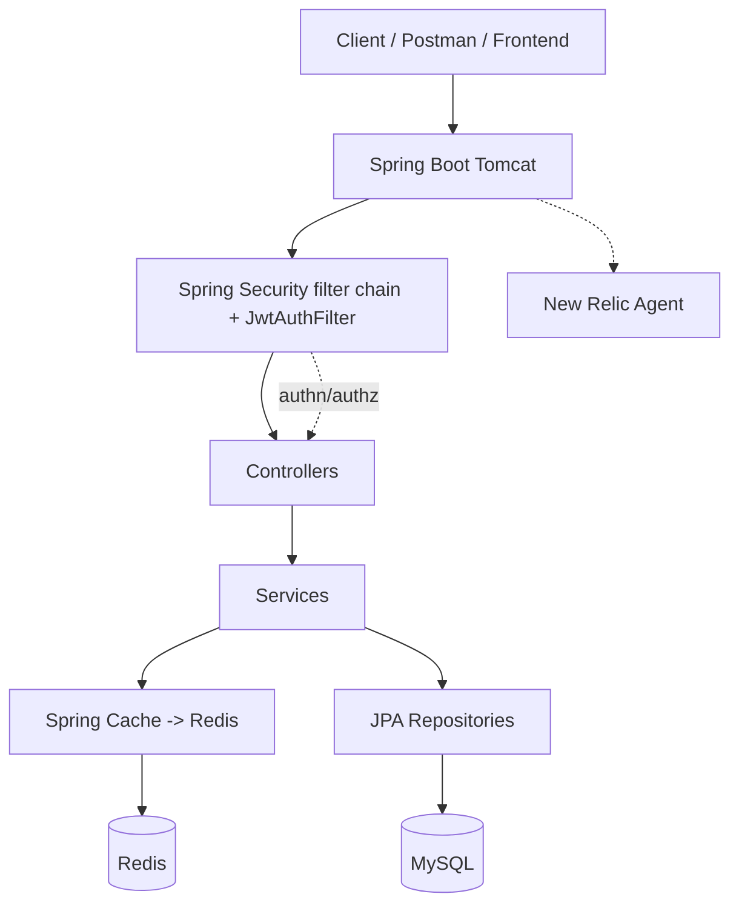
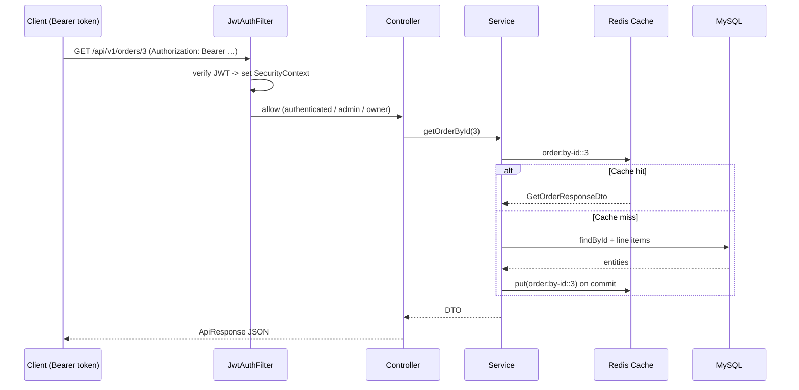
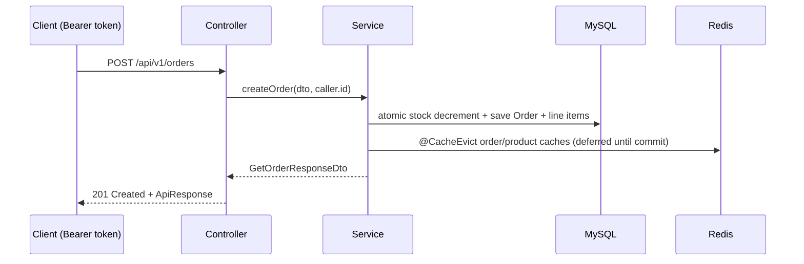
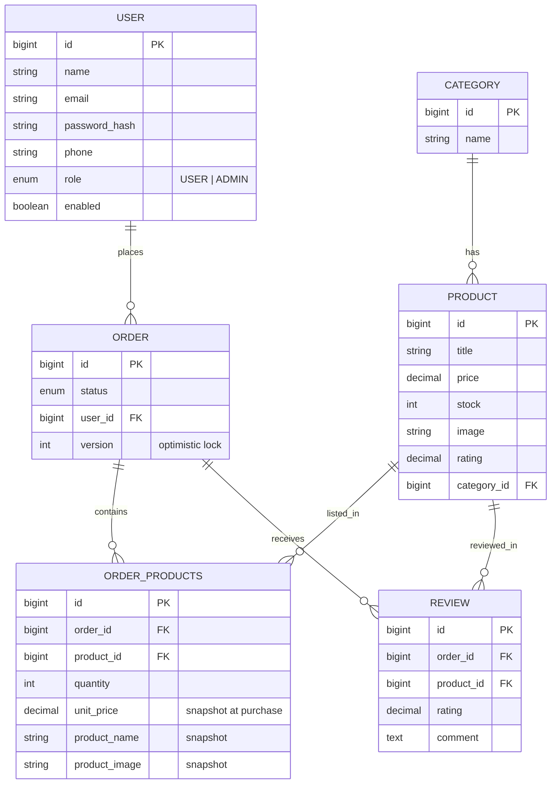

# NexusCommerce — Project Documentation

Complete reference for setup, technology stack, authentication, architecture, data-integrity guarantees, Redis caching, API flows, request payloads, observability, and real-world usage scenarios.

---

## Table of contents

1. [Overview](#1-overview)
2. [Technologies used](#2-technologies-used)
3. [Environment setup](#3-environment-setup)
4. [Application configuration](#4-application-configuration)
5. [Running the project](#5-running-the-project)
6. [Architecture and request flow](#6-architecture-and-request-flow)
7. [Authentication & authorization](#7-authentication--authorization)
8. [Domain model](#8-domain-model)
9. [Data integrity & migrations](#9-data-integrity--migrations)
10. [Redis caching](#10-redis-caching)
11. [Observability](#11-observability)
12. [API reference and payloads](#12-api-reference-and-payloads)
13. [Real-life scenarios](#13-real-life-scenarios)
14. [Error handling](#14-error-handling)
15. [Manual testing checklist](#15-manual-testing-checklist)

---

## 1. Overview

**NexusCommerce** is a Spring Boot REST backend for a small e-commerce platform. It manages:

- **Users** — accounts with a hashed password and a role (`USER` / `ADMIN`); registration and JWT login.
- **Categories** — product groupings (e.g. Electronics).
- **Products** — catalogue items linked to a category, each with a **stock** count.
- **Orders** — purchases with line items (product + quantity), placed by an authenticated user; stock is reserved atomically and line items are **snapshotted**.
- **Reviews** — post-purchase feedback tied to a specific order and product.

Every call beyond public browsing is secured with a **stateless JWT bearer token** and **role-based authorization**.

All REST responses use a consistent **`ApiResponse<T>`** envelope. Read-heavy product, order, category, and review GET endpoints are cached in **Redis** through Spring's cache abstraction, and every write **evicts** the affected cache entries. **MySQL** is the system of record; **Flyway** owns the schema (`V1`–`V12`) and Hibernate runs in `validate` mode only.

**Base URL:** `http://localhost:<PORT>/api/v1` (default `PORT` from `.env`, commonly `3001`).

---

## 2. Technologies used

| Technology | Role in NexusCommerce | Version (project) |
|------------|----------------------|-------------------|
| **Java** | Runtime | 21 |
| **Spring Boot** | Web, DI, auto-configuration | 4.0.2 |
| **Spring WebMVC** | REST controllers | (via starter) |
| **Spring Security** | Stateless auth + method/path authorization | 7.x |
| **JWT (`jjwt`)** | Token issue & verification (HMAC) | (managed) |
| **Spring Data JPA** | Repositories, ORM | (via starter) |
| **Hibernate** | JPA provider, `ddl-auto: validate` | 7.x |
| **MySQL** | Primary database | 8.x+ compatible |
| **Flyway** | Versioned SQL migrations (`V1`–`V12`) | (via starter) |
| **Redis + Lettuce** | Spring Cache backend for GET APIs | Spring Data Redis |
| **Lombok** | Boilerplate reduction | compileOnly |
| **springdoc-openapi** | Swagger UI / OpenAPI 3 (+ bearer scheme) | 2.8.5 |
| **Gradle** | Build and `bootRun` | 9.x wrapper |
| **New Relic Java agent** | APM on `bootRun` | `newrelic/` directory |
| **Jackson** | JSON (API + Redis value serialization) | (Spring Boot managed) |

---

## 3. Environment setup

### 3.1 Prerequisites

Install on your machine:

| Tool | Purpose |
|------|---------|
| **JDK 21** | Compile and run |
| **MySQL** | Database server |
| **Redis** | Cache server |
| **Git** | Clone repo (optional) |

Verify:

```bash
java -version    # should show 21
mysql --version
redis-cli --version
```

### 3.2 MySQL setup

1. Start MySQL service.
2. Create database:

```sql
CREATE DATABASE nexuscommerce CHARACTER SET utf8mb4 COLLATE utf8mb4_unicode_ci;
```

3. Ensure a user can connect to `localhost:3306` with rights on `nexuscommerce`.

**Tables** are created and versioned by **Flyway** on first app start (migrations `V1`–`V12` under `src/main/resources/db/migration/`). Hibernate only validates the schema; it never alters it.

### 3.3 Redis setup

1. Start Redis (default port **6379**):

```bash
# macOS (Homebrew example)
brew services start redis

# or foreground
redis-server
```

2. Verify:

```bash
redis-cli ping
# PONG
```

The cache is optional to start: if Redis is down, a `CacheErrorHandler` lets reads fall through to MySQL, and the client has 500 ms connect/response timeouts so a hung Redis cannot pin a request thread.

### 3.4 Project configuration file (`.env`)

Create `.env` in the project root (git-ignored — never commit it):

```properties
PORT=3001
username=your_mysql_user
password=your_mysql_password
redis_port=6379
JWT_SECRET=change-me-to-a-long-random-secret-at-least-32-bytes
JWT_EXPIRATION_MINUTES=120
```

Spring loads it via `spring.config.import: optional:file:.env[.properties]` in `application.yml`. `JWT_SECRET` has a dev-only default baked into `application.yml` so the app boots without a secret file, but **always override it outside local dev**.

### 3.5 New Relic (optional)

- Agent JAR and config: `newrelic/newrelic.jar`, `newrelic/newrelic.yml`
- `app_name` is **NexusCommerce**
- Set **license key** in `newrelic.yml` or env (e.g. `NEW_RELIC_LICENSE_KEY`); do not commit secrets
- `./gradlew bootRun` attaches `-javaagent:newrelic/newrelic.jar` (see `build.gradle`)
- To run **without** New Relic, remove or override `bootRun` `jvmArgs` in Gradle/IDE

---

## 4. Application configuration

| Property | Source | Description |
|----------|--------|-------------|
| `server.port` | `${PORT}` | HTTP port (commonly `3001`) |
| `server.compression` | `application.yml` | gzip on JSON responses ≥ 2 KB |
| `spring.datasource.url` | `application.yml` | `jdbc:mysql://localhost:3306/nexuscommerce` (+ prepared-statement cache, batch rewrite) |
| `spring.datasource.username` | `${username}` | MySQL user |
| `spring.datasource.password` | `${password}` | MySQL password |
| `spring.datasource.hikari` | `application.yml` | pool max 20, min idle 5, 3 s checkout timeout |
| `spring.data.redis.host` | `application.yml` | `localhost` |
| `spring.data.redis.port` | `${redis_port}` | Redis port |
| `spring.data.redis.timeout` / `connect-timeout` | `application.yml` | 500 ms each — turns a hung Redis into a fast fallback, not a stall |
| `spring.jpa.hibernate.ddl-auto` | `validate` | Schema managed by Flyway only |
| `spring.jpa.show-sql` | `false` | SQL off; use the `org.hibernate.SQL` logger when needed |
| `spring.jpa.open-in-view` | `false` | Requests never hold a DB connection through serialization; fetch associations explicitly |
| `spring.flyway.enabled` | `true` | Runs migrations on startup |
| `app.jwt.secret` | `${JWT_SECRET}` | HMAC signing key (≥ 32 bytes) |
| `app.jwt.expiration-minutes` | `${JWT_EXPIRATION_MINUTES}` | Token lifetime (default 120) |

---

## 5. Running the project

```bash
cd NexusCommerce
./gradlew bootRun
```

**Swagger UI:** `http://localhost:<PORT>/swagger-ui/index.html`
**OpenAPI JSON:** `http://localhost:<PORT>/v3/api-docs`

Swagger exposes an **Authorize** button (bearer scheme): log in, copy `data.token`, paste it there, and protected endpoints become callable.

**Tests:**

```bash
./gradlew test
```

---

## 6. Architecture and request flow

### 6.1 High-level architecture



### 6.2 Layered flow (single authenticated GET request)



### 6.3 Typical write flow (evicts cache on commit)



> **Note:** Writes **do** invalidate the relevant cache entries. Eviction is scheduled to run only after the surrounding transaction commits, so a rolled-back write never leaves a stale-but-cached result, and a concurrent read never populates the cache from pre-commit data.

### 6.4 Project package layout

```
com.example.nexusCommerce/
├── controllers/     REST API (Auth, Users, Categories, Products, Orders, Reviews, Admin)
├── services/        Business logic (interface + *ServiceImpl)
├── repositories/    Spring Data JPA
├── schema/          Entities (Category, Product, Order, OrderProducts, Review, User) + Role/OrderStatus enums
├── dtos/            Request/response objects
├── adapters/        Entity ↔ DTO mapping (OrderAdapter, ReviewAdapter, …)
├── security/        JwtService, JwtAuthFilter, AuthenticatedUser
├── exceptions/      Custom exceptions + GlobalExceptionHandler
├── configs/         SecurityConfig, CacheConfig, JpaAuditingConfig, PasswordEncoderConfig, SwaggerConfig
└── utils/           ApiResponse, PageResponse, Pagination
```

Caching is declarative (`@Cacheable` / `@CacheEvict`) on the service methods — there is **no** hand-written cache class per domain.

---

## 7. Authentication & authorization

### 7.1 Token lifecycle

Stateless JWT. Register once, then log in to obtain a bearer token and send it on every protected request.

1. **Register** — `POST /api/v1/users` (public). New accounts get role `USER`. Password is **BCrypt-hashed** before storage.
2. **Log in** — `POST /api/v1/auth/login` (public) → returns `{ token, tokenType: "Bearer", expiresAt, user }`.
3. **Call** — send `Authorization: Bearer <token>`. `JwtAuthFilter` verifies the signature and expiry and populates an `AuthenticatedUser(id, email, role)` principal available to controllers via `@AuthenticationPrincipal`.

**Claims:** `sub` = email, `uid` = user id, `role`. Signed with the HMAC `JWT_SECRET` (algorithm derived from key length; the bundled dev secret yields HS512). Invalid, expired, or unsigned tokens are treated as unauthenticated.

**Bootstrapping the first admin:** every self-registered account is a `USER`. Promote an admin by setting that row's `role` to `ADMIN` in the database (or via an existing admin through `PATCH /api/v1/admin/users/{id}`), then log in again — the role travels in the token.

### 7.2 Authorization matrix (from `SecurityConfig`)

| Access level | Routes |
|--------------|--------|
| **Public (no token)** | `/api/v1/auth/**`, `POST /api/v1/users`, Swagger/OpenAPI paths, and **GET** on `/api/v1/products/**`, `/api/v1/categories/**`, `/api/v1/reviews/**` (browsing the catalogue and reading reviews). |
| **Any authenticated user** | `POST /api/v1/reviews`, `POST /api/v1/orders`, `GET /api/v1/orders/me`, `GET /api/v1/orders/{id}`, `GET /api/v1/orders/{id}/summary`, `PUT /api/v1/orders/{id}` — order read/update are additionally scoped so a non-admin can only touch their **own** orders. |
| **`ROLE_ADMIN` only** | All **writes** on products and categories (POST/PUT/DELETE), **DELETE** on reviews, the order **list** (`GET /api/v1/orders`), **DELETE** on orders, the entire `/api/v1/admin/**`, and viewing any user's orders via `GET /api/v1/orders/user/{userId}`. |

Anything not matched above requires authentication. `401 Unauthorized!` is returned when a token is missing/invalid; `403 Forbidden!` when the caller is authenticated but lacks the role or ownership.

### 7.3 Password & secret handling

- `PasswordEncoderConfig` exposes a BCrypt encoder; plaintext passwords are never stored or returned.
- The JWT secret comes from `JWT_SECRET`; the fallback in `application.yml` is a fixed dev-only value. Rotate it for any real deployment.

---

## 8. Domain model



Every table also carries `created_datetime`, `updated_datetime`, and (via soft-delete) `deleted_datetime`.

**Review rules:**

- Product must exist on the order (as a line item).
- At most **one review per (orderId, productId)** — enforced at the DB level on live rows.
- Rating: **> 0** and **≤ 10**.

---

## 9. Data integrity & migrations

Design guarantees that are worth knowing before modifying the domain:

- **Soft delete everywhere** — Every entity uses `@SQLDelete` (UPDATE … SET `deleted_datetime`) + `@SQLRestriction(deleted_datetime IS NULL)`. Deletes hide rows from reads without destroying history.
- **Optimistic locking** — `Order` has a `@Version` column (added in `V8`); its soft-delete SQL is version-guarded so concurrent writers collide instead of silently overwriting.
- **Oversell-safe stock** — Reserving/adjusting stock uses an atomic conditional bulk UPDATE (`WHERE stock >= :qty`). Zero affected rows means insufficient stock and the whole transaction rolls back, so partial oversells cannot commit. Returning stock on delete/remove is an atomic `increaseStock`.
- **Line-item snapshots** — `order_products` stores `unit_price` (`V11`) plus `product_name` / `product_image` (`V12`), all backfilled. Editing a price, renaming, or soft-deleting a product therefore cannot rewrite historical orders or revenue, and a deleted product's line item still renders (the read path no longer inner-joins products).
- **Uniqueness that survives soft-delete** — Flyway generated columns mirror each unique key only for live rows (`V8` unique names, `V10` one live review per `(order, product)`), so deleting a row frees the slot without a partial index.
- **Schema is code** — `ddl-auto: validate`; **Flyway** owns DDL. Add a new `V__` migration for any change — never edit an applied one.

### Migration history

| Migration | Purpose |
|-----------|---------|
| `V1__init_schema` | Initial categories/products/orders/order_products tables |
| `V2__update_rating_to_decimal` | rating → decimal |
| `V3__add_reviews_table` | reviews table |
| `V4__add_product_price_index` | index on product price |
| `V5__add_users_and_order_user` | users table + order→user link |
| `V6__add_password_hash_to_users` | `password_hash` for auth |
| `V7__lookup_indexes` | FK/lookup indexes |
| `V8__order_version_and_unique_names` | order `version` + soft-delete-safe unique names |
| `V9__add_role_and_stock` | `users.role` + `products.stock` |
| `V10__unique_active_review` | DB unique on live `(order_id, product_id)` reviews |
| `V11__snapshot_order_unit_price` | `order_products.unit_price` snapshot (backfilled) |
| `V12__snapshot_order_product_identity` | `order_products.product_name` / `product_image` snapshot (backfilled) |

---

## 10. Redis caching

### 10.1 Pattern

Spring's **cache abstraction** (`@EnableCaching`) backed by **`RedisCacheManager`** over **Lettuce**. Service methods are annotated `@Cacheable` (reads) and `@CacheEvict` / `@Caching` (writes) — there is no manual cache-aside code.

- **Values:** JSON via a Jackson serializer; keys are strings. At runtime Spring prefixes the key with the cache name, e.g. `product:by-id::1`, `order:all::0:20`.
- **TTLs (per cache):** list caches **5 min**, single-item caches **10 min**, aggregate `product:unique-categories` **15 min**.
- **Null caching:** on — a lookup of a non-existent id is memoized so it cannot hammer the DB.
- **Transaction-aware:** puts/evictions are deferred until the surrounding transaction commits.
- **Resilience:** a `CacheErrorHandler` degrades to the database on Redis failures, and 500 ms timeouts bound any hang. A local fallback (`spring.cache.type` != `redis`) uses an in-memory cache manager.

### 10.2 Cache names & key expressions

| Cache name | Key | Populated by | Evicted on |
|------------|-----|--------------|------------|
| `product:all` | `page:size` | list | product/category writes (all entries) |
| `product:by-id` | `id` | get by id | product updates (all entries) |
| `product:details` | `id` | get with details | product updates (all entries) |
| `product:by-category` | `name:page:size` | search by category | product/category writes |
| `product:unique-categories` | — | distinct category names | product writes |
| `category:all` | `page:size` | list | category writes |
| `category:by-id` | `id` | get by id | category writes |
| `order:all` | `page:size` | admin list | order writes (all entries) |
| `order:by-id` | `id` | get order | order writes on that id |
| `order:summary` | `id` | get summary | order writes on that id |
| `review:all` | `page:size` | list | review writes |
| `review:by-id` | `id` | get by id | review writes |
| `review:by-product` | `productId:page:size` | by product | review writes |
| `review:by-order` | `orderId:page:size` | by order | review writes |

Because list keys include `page`/`size`, list evictions use `allEntries = true`.

Inspect keys:

```bash
redis-cli -p 6379 KEYS "product:*"
redis-cli -p 6379 KEYS "order:*"
redis-cli -p 6379 --scan --pattern "review:*" | head
```

---

## 11. Observability

| Item | Detail |
|------|--------|
| APM | `-javaagent:newrelic/newrelic.jar` on `bootRun`; app name **NexusCommerce** |
| Visibility | HTTP transactions, JDBC/MySQL calls, JVM metrics, errors |
| Agent logs | `newrelic/logs/newrelic_agent.log` |
| App SQL logs | `spring.jpa.show-sql: false` — enable the `org.hibernate.SQL` logger for debugging |
| Not included | Spring Boot Actuator / Micrometer endpoints (optional extension; if added, gate `/actuator/**` behind `ROLE_ADMIN`) |

---

## 12. API reference and payloads

### 12.1 Response envelope

**Success:**

```json
{ "success": true, "message": "Human-readable message", "error": null, "data": { } }
```

**Error:**

```json
{ "success": false, "message": "Resource Not Found!", "error": "Detailed error text", "data": null }
```

Paged `data` is a **`PageResponse`**:

```json
{ "content": [ ], "page": 0, "size": 20, "totalElements": 137, "totalPages": 7, "last": false }
```

List endpoints accept `?page=0&size=20` (defaults shown; `size` is clamped server-side). Add `-H "Authorization: Bearer <token>"` for any non-public route.

### 12.2 Auth & users

| Method | Path | Access | Body |
|--------|------|--------|------|
| POST | `/api/v1/users` | Public | `CreateUserRequestDto` |
| POST | `/api/v1/auth/login` | Public | `LoginRequestDto` |

**Register (`CreateUserRequestDto`):** `name` (required), `email` (valid, unique), `password` (≥ 8 chars), `phone` (optional). Returns 201 with the created user (`role: "USER"`).

**Register body (`CreateUserRequestDto`):**

```json
{ "name": "Rahul", "email": "rahul@example.com", "password": "secret123", "phone": "9999999999" }
```

**Login body (`LoginRequestDto`):**

```json
{ "email": "rahul@example.com", "password": "secret123" }
```

Response `data`:

```json
{ "token": "<jwt>", "tokenType": "Bearer", "expiresAt": "2026-10-21T12:00:00Z",
  "user": { "id": 4, "name": "Rahul", "email": "…", "role": "USER", "enabled": true } }
```

### 12.3 Categories — `/api/v1/categories`

| Method | Path | Access | Body | Cache |
|--------|------|--------|------|-------|
| GET | `/` | Public | page/size | `category:all` |
| GET | `/{id}` | Public | — | `category:by-id` |
| POST | `/` | ADMIN | below | evict |
| PUT | `/{id}` | ADMIN | below | evict |
| DELETE | `/{id}` | ADMIN | — | evict (rejected if it has live products) |

**Body (`CreateCategoryRequestDto`):** `{ "name": "Electronics" }`

### 12.4 Products — `/api/v1/products`

| Method | Path | Access | Body / params | Cache |
|--------|------|--------|---------------|-------|
| GET | `/` | Public | page/size | `product:all` |
| GET | `/{id}` | Public | — | `product:by-id` |
| GET | `/{id}/details` | Public | — | `product:details` |
| GET | `/search?categoryName=` | Public | + page/size | `product:by-category` |
| GET | `/uniqueCategories` | Public | — | `product:unique-categories` |
| POST | `/` | ADMIN | below | evict |
| PUT | `/{id}` | ADMIN | below (partial) | evict |
| DELETE | `/{id}` | ADMIN | — | evict (soft delete) |

**POST body (`CreateProductRequestDto`):**

```json
{
  "title": "Wireless Headphones",
  "description": "Noise-cancelling over-ear headphones",
  "price": 4999.00,
  "image": "https://example.com/headphones.png",
  "categoryId": 1,
  "rating": 4.5,
  "stock": 25
}
```

**PUT body (`UpdateProductRequestDto`)** is a **partial merge** — only non-null fields change (any of `title`, `description`, `price`, `image`, `rating`, `stock`, `categoryId`).

**PUT body example (`UpdateProductRequestDto`, partial — change only `price` and `stock`):**

```json
{ "price": 4599.00, "stock": 40 }
```

### 12.5 Orders — `/api/v1/orders`

| Method | Path | Access | Body | Cache |
|--------|------|--------|------|-------|
| POST | `/` | User | below | evict |
| GET | `/me` | User | page/size | — |
| GET | `/{id}` | Owner/ADMIN | — | `order:by-id` |
| GET | `/{id}/summary` | Owner/ADMIN | — | `order:summary` |
| PUT | `/{id}` | Owner/ADMIN | below | evict |
| GET | `/` | ADMIN | page/size | `order:all` |
| GET | `/user/{userId}` | Owner/ADMIN | page/size | — |
| DELETE | `/{id}` | ADMIN | — | evict |

**POST body (`CreateOrderRequestDto`):** placed on the authenticated caller; reserves stock atomically.

```json
{ "orderItems": [ { "productId": 1, "quantity": 2 } ] }
```

**PUT body (`UpdateOrderRequestDto`):** `status` and/or `orderItems` actions. Blocked once the order is `DELIVERED` or `CANCELLED`.

```json
{
  "status": "SHIPPED",
  "orderItems": [ { "productId": 1, "quantity": 1, "action": "ADD" } ]
}
```

- `action` (`OrderItemAction`): `ADD`, `REMOVE`, `INCREMENT`, `DECREMENT`
- `status` (`OrderStatus`): `PENDING`, `SHIPPED`, `DELIVERED`, `CANCELLED`

Line items in the response are rendered from the stored snapshots (`productName`, `productPrice` = unit price, `subTotal` = unit price × qty).

> The `GET` order endpoints (`/me`, `/{id}`, `/{id}/summary`, `/user/{userId}`, `/`) have **no body** — just the path id and optional `page`/`size`. `POST` and `PUT` bodies are shown above.

### 12.6 Reviews — `/api/v1/reviews`

| Method | Path | Access | Body | Cache |
|--------|------|--------|------|-------|
| GET | `/` | Public | page/size | `review:all` |
| GET | `/{id}` | Public | — | `review:by-id` |
| GET | `/product/{productId}` | Public | page/size | `review:by-product` |
| GET | `/order/{orderId}` | Public | page/size | `review:by-order` |
| POST | `/` | User | below | evict |
| DELETE | `/{id}` | ADMIN | — | evict |

**POST body (`CreateReviewRequestDto`):**

```json
{ "orderId": 3, "productId": 1, "rating": 8.5, "comment": "Great product, fast delivery" }
```

| Field | Required | Rules |
|-------|----------|-------|
| `orderId` | Yes | must exist |
| `productId` | Yes | must exist and be a line item on that order |
| `rating` | Yes | > 0 and ≤ 10 |
| `comment` | No | trimmed; blank → stored as null |

Duplicate `(orderId, productId)` on a live review → **409**.

### 12.7 Admin — `/api/v1/admin` (all `ROLE_ADMIN`)

| Method | Path | Body | Description |
|--------|------|------|-------------|
| GET | `/metrics` | — | `AdminMetricsResponseDto`: totals (users/products/categories/orders/reviews), `totalRevenue`, `ordersByStatus`, `outOfStockProducts` |
| GET | `/users` | page/size | List users |
| GET | `/users/{id}` | — | Get a user |
| PATCH | `/users/{id}` | `{ "role": "…", "enabled": true/false }` | Update role/enabled (last-active-admin can't be disabled) |
| PUT | `/products/{id}/stock` | `{ "stock": 100 }` (≥ 0) | Set a product's stock |

**PATCH body (`UpdateUserRequestDto`)** — either or both fields:

```json
{ "role": "ADMIN", "enabled": true }
```

**PUT body (`SetStockRequestDto`):**

```json
{ "stock": 100 }
```

---

## 13. Real-life scenarios

### Scenario A: New customer browses the catalogue (public)

| Step | Action | API |
|------|--------|-----|
| 1 | Load category filters | `GET /products/uniqueCategories` |
| 2 | Browse Electronics | `GET /products/search?categoryName=Electronics&page=0&size=20` |
| 3 | Open product page | `GET /products/1/details` |

No token needed. Repeat step 3 — the second call hits `product:details::1` in Redis.

### Scenario B: Sign up, log in, place an order (auth)

| Step | Action | API |
|------|--------|-----|
| 1 | Register | `POST /users` |
| 2 | Log in → capture token | `POST /auth/login` |
| 3 | Place order (2 units) | `POST /orders` with `Authorization: Bearer …` |
| 4 | Confirm + totals | `GET /orders/{id}` and `GET /orders/{id}/summary` |

Stock is decremented atomically. Creating the order evicts `order:*` and `product:*` entries, so the next product list reflects the new stock without waiting for TTL.

### Scenario C: Review a purchased product

| Step | Action | API |
|------|--------|-----|
| 1 | Confirm order + product | `GET /orders/{id}` |
| 2 | Submit review (authenticated) | `POST /reviews` with matching `orderId` + `productId` |
| 3 | Ratings on product page | `GET /reviews/product/1` |

**Failure:** product not on the order → **400**. Duplicate → **409**. Creating reviews requires a token (public reads do not).

### Scenario D: Admin runs the store

| Step | Action | API |
|------|--------|-----|
| 1 | Log in as admin | `POST /auth/login` |
| 2 | Add category / product | `POST /categories`, `POST /products` (ADMIN) |
| 3 | Restock a product | `PUT /admin/products/{id}/stock` |
| 4 | Check dashboard | `GET /admin/metrics` |
| 5 | Moderate a review | `DELETE /reviews/{id}` (ADMIN) |

### Scenario E: Order edits and integrity

| Step | Action | API |
|------|--------|-----|
| 1 | Add another line while `PENDING` | `PUT /orders/{id}` with `action: "ADD"` |
| 2 | Cancel after delivery | `PUT /orders/{id}` `{"status":"CANCELLED"}` — then updates/deletes are blocked (terminal status) |

Historical orders are immutable in effect: the line items keep their snapshotted price/name/image even if the product is later edited or deleted.

### Scenario F: Ops monitors & validates cache

1. Run with New Relic agent; open the NexusCommerce APM view.
2. `redis-cli FLUSHDB` (local only), then call a GET twice → observe miss then hit.
3. Do a write and confirm the matching `order:*` / `product:*` keys are evicted immediately (no TTL wait).

---

## 14. Error handling

| HTTP status | Source | Example `error` / message |
|-------------|--------|---------------------------|
| **401** | No/invalid token on a protected route | `message: "Unauthorized!"` |
| **403** | Authenticated but wrong role / not owner | `message: "Forbidden!"` |
| **404** | `ResourceNotFoundException` | `Product with id: 99 Not Found!` |
| **409** | `DuplicateResourceException` | `A review already exists for this order and product` |
| **400** | `InvalidRequestException` / Bean Validation / ownership guard | `You can only access your own orders`, `stock must not be negative`, `Order cannot be modified in DELIVERED/CANCELLED status` |
| **500** | Unhandled | `Something went wrong!` + exception message |

`401`/`403` are emitted by the security filter in the same `ApiResponse` shape as the rest of the API.

---

## 15. Manual testing checklist

Use `PORT=3001` (or your `.env` value). First get a token:

- [ ] `POST /api/v1/users` (register) → `POST /api/v1/auth/login` → copy `data.token`
- [ ] Confirm an unauthenticated `POST /api/v1/orders` returns **401**
- [ ] Repeat it with `-H "Authorization: Bearer <token>"` → **201**

### Public reads (cache)

- [ ] `GET /api/v1/categories` ×2 → `GET /api/v1/categories/1` ×2
- [ ] `GET /api/v1/products` ×2 → `/products/1` ×2 → `/products/1/details` ×2 → `/products/search?categoryName=Electronics` ×2 → `/products/uniqueCategories` ×2
- [ ] `GET /api/v1/reviews` ×2 → `/reviews/{id}` ×2 → `/reviews/product/1` ×2 → `/reviews/order/{id}` ×2

### Orders (authenticated, owner-scoped)

- [ ] `POST /api/v1/orders` (token) → note `data.id`
- [ ] `GET /api/v1/orders/me`
- [ ] `GET /api/v1/orders/{id}` and `/{id}/summary` (owner)
- [ ] Access someone else's order id → **403**/400 ownership rejection

### Admin (ADMIN token)

- [ ] `GET /api/v1/admin/metrics`
- [ ] `GET /api/v1/admin/users` → `PATCH /api/v1/admin/users/{id}` (toggle `enabled`)
- [ ] `PUT /api/v1/admin/products/{id}/stock` → verify stock via `GET /products/{id}`
- [ ] `POST /api/v1/products` and `DELETE /api/v1/categories/{id}` require ADMIN (USER token → **403**)

### Integrity spot-checks

- [ ] Order for more than available stock → **400**/rollback, no partial decrement
- [ ] After `PUT /admin/products/{id}/stock`, a subsequent `GET /products` is fresh (eviction, not TTL)

### End-to-end journey

1. Register → login → browse (`GET /products/search`) → place order (`POST /orders`) → `GET /orders/{id}/summary`
2. `POST /reviews` for an ordered product → `GET /reviews/product/{productId}`

---

## Document info

| Field | Value |
|-------|--------|
| Application | **NexusCommerce** |
| API version prefix | `/api/v1` |
| Schema version (Flyway) | **V12** |
| Related file | `README.md` (shorter overview) |

For interactive exploration, prefer **Swagger UI** at `/swagger-ui/index.html`, then click **Authorize** and paste a bearer token.
